# TÀI LIỆU ĐẶC TẢ NGHIỆP VỤ & KIẾN TRÚC TOÀN HỆ THỐNG
# HRM ENTERPRISE — HỆ THỐNG QUẢN TRỊ NHÂN SỰ & VẬN HÀNH CA KÍP

> **DÀNH CHO AI CHATBOT & HỆ THỐNG TRUY VẤN TỰ ĐỘNG:**  
> Tài liệu này được cấu trúc hóa ở mức độ chính xác cao (High-Signal Specification) để bất kỳ AI Chatbot hoặc mô hình ngôn ngữ lớn (LLM) nào có thể hiểu toàn diện: **Dự án làm gì**, **Đáp án cuối cùng tạo ra được gì**, **Kiến trúc các dịch vụ microservices**, **Quy tắc toán học & nghiệp vụ bất biến**, và **Cách các dịch vụ tương tác dữ liệu khép kín**.

---

## MỤC LỤC
0. [BẢN CHẤT DỰ ÁN: DỰ ÁN NÀY LÀM GÌ & ĐÁP ÁN CUỐI CÙNG RA ĐƯỢC GÌ?](#0-bản-chất-dự-án-dự-án-này-làm-gì--đáp-án-cuối-cùng-ra-được-gì)
   - 0.1. [Bảng Định Danh Nhanh Cho AI (System Primer Metadata)](#01-bảng-định-danh-nhanh-cho-ai-system-primer-metadata)
   - 0.2. [Dự án này làm gì? (Business Domain & Problem Statement)](#02-dự-án-này-làm-gì-business-domain--problem-statement)
   - 0.3. [Đáp án cuối cùng của dự án ra được gì? (Final Deliverables & Tangible Outputs)](#03-đáp-án-cuối-cùng-của-dự-án-ra-được-gì-final-deliverables--tangible-outputs)
   - 0.4. [Đối tượng Sử dụng & 4 Hành trình Nghiệp vụ Đầu-Cuối (User Personas & End-to-End Journeys)](#04-đối-tượng-sử-dụng--4-hành-trình-nghiệp-vụ-đầu-cuối-user-personas--end-to-end-journeys)
   - 0.5. [Bộ Quy tắc Bất biến & Công thức Toán học Cốt lõi (Invariants & Formulas)](#05-bộ-quy-tắc-bất-biến--công-thức-toán-học-cốt-lõi-invariants--formulas)
1. [TỔNG QUAN KIẾN TRÚC HỆ THỐNG (SOA ARCHITECTURE & DB-PER-SERVICE)](#1-tổng-quan-kiến-trúc-hệ-thống-soa-architecture)
2. [DỊCH VỤ 1: API GATEWAY SERVICE (`backend/api-gateway` - Port 4000)](#2-dịch-vụ-1-api-gateway-service-backendapi-gateway---port-4000)
3. [DỊCH VỤ 2: IDENTITY SERVICE (`backend/identity-service` - Port 4001)](#3-dịch-vụ-2-identity-service-backendidentity-service---port-4001)
4. [DỊCH VỤ 3: ORGANIZATION SERVICE (`backend/organization-service` - Port 4002)](#4-dịch-vụ-3-organization-service-backendorganization-service---port-4002)
5. [DỊCH VỤ 4: PAYROLL SERVICE (`backend/payroll-service` - Port 4004)](#5-dịch-vụ-4-payroll-service-backendpayroll-service---port-4004)
6. [DỊCH VỤ 5: WORK SERVICE (`backend/work-service` - Port 4003)](#6-dịch-vụ-5-work-service-backendwork-service---port-4003)
7. [DỊCH VỤ 6: INTEGRATION SERVICE (`backend/integration-service` - Port 4005)](#7-dịch-vụ-6-integration-service-backendintegration-service---port-4005)
8. [MA TRẬN TRA CỨU NHANH CHO AI CHATBOT (AI QUICK REFERENCE MATRIX)](#8-ma-trận-tra-cứu-nhanh-cho-ai-chatbot-ai-quick-reference-matrix)

---

## 0. BẢN CHẤT DỰ ÁN: DỰ ÁN NÀY LÀM GÌ & ĐÁP ÁN CUỐI CÙNG RA ĐƯỢC GÌ?

### 0.1. Bảng Định Danh Nhanh Cho AI (System Primer Metadata)
| Thuộc tính (Attribute) | Giá trị đặc tả kỹ thuật (Specification) |
|---|---|
| **Tên Hệ Thống** | **HRM Enterprise** — Hệ thống Quản trị Nhân sự, Vận hành Ca kíp & Chi lương Chuỗi đa Chi nhánh |
| **Kiểu Kiến Trúc (Architecture)** | On-Premises SOA / Microservices, Eventual Consistency, Database-per-service (5 PostgreSQL độc lập) |
| **Giao thức Truyền dẫn** | RESTful JSON Envelope (`{ data }`, `{ error }`), SOAP XML 1.1/1.2 (`text/xml`), HTTP internal calls (timeout 5000ms) |
| **Công nghệ Tầng Client** | Web Portal (Next.js 16, App Router, Tailwind CSS) + Mobile App (Flutter 3.x, Material 3, Android/iOS) |
| **Công nghệ Tầng Backend** | Node.js (v20+), Express.js, Prisma ORM, JSON Web Token (JWT), Bcrypt, Cloudinary SDK |
| **Phạm vi Cổng (Ports)** | `3000` (Web Portal) \| `4000` (API Gateway) \| `4001` (Identity) \| `4002` (Org) \| `4003` (Work) \| `4004` (Payroll) \| `4005` (Integration) |
| **Chế độ Xác thực** | Multi-source: HttpOnly Cookie `hrm-session` (Web) + Header `Authorization: Bearer <token>` (Mobile/Client) |
| **Cơ chế Lan truyền Danh tính** | API Gateway verify JWT in-memory và tiêm các header: `x-user-id`, `x-user-role`, `x-branch-slug` xuống các microservices |

---

### 0.2. Dự án này làm gì? (Business Domain & Problem Statement)

#### 1. Bài toán Thực tế của Doanh nghiệp (Pain Points)
Các doanh nghiệp vận hành chuỗi bán lẻ, nhà hàng, chuỗi siêu thị hoặc chuỗi dịch vụ phân tán (ví dụ: các chi nhánh HN-1 Hoàn Kiếm, HN-2 Cầu Giấy, DN-1 Đà Nẵng) gặp 4 bài toán đau đầu:
1. **Gian lận chấm công (Buddy Punching & Fake GPS):** Nhân viên nhờ người khác chấm công hộ, fake định vị GPS khi chưa có mặt tại cửa hàng.
2. **Hỗn loạn trong phân chia & đổi ca làm việc:** Quản lý cửa hàng dùng bảng tính Excel rời rạc hoặc nhóm chat Zalo/Telegram; nhân viên xin nghỉ hoặc đổi ca khó kiểm soát, dễ trùng lịch hoặc thiếu người trong ca.
3. **Tính lương thủ công sai sót:** Cuối tháng kế toán phải gộp dữ liệu từ nhiều file Excel chấm công, tự đếm số lần đi muộn/về sớm để trừ phạt thủ công dẫn đến tranh chấp lương và sai lệch số liệu.
4. **Chi trả lương ngân hàng chậm trễ & rủi ro chi trùng:** Chuyển khoản lương thủ công từng người mất nhiều ngày; khi mạng chập chờn dễ bấm nhầm chuyển 2 lần cho cùng một nhân viên gây thất thoát tài chính.

#### 2. Sứ mệnh & Chức năng Cốt lõi của Dự án (Core System Capabilities)
HRM Enterprise là một nền tảng quản trị hợp nhất giải quyết triệt để 4 vấn đề trên thông qua:
1. **Quản trị Tổ chức Tập trung:** Quản lý cây cơ cấu chi nhánh, phòng ban, và hồ sơ nhân viên thống nhất cho toàn chuỗi.
2. **Vận hành Ca kíp Linh hoạt & Đổi ca Tự động:** Tạo mẫu ca tiêu chuẩn, phân ca theo ngày/tuần, hỗ trợ nhân viên nộp đơn đổi ca trực tiếp trên app di động và tự động cập nhật phân ca khi quản lý duyệt.
3. **Chấm công Thông minh Chống Gian lận qua Wi-Fi Chi nhánh:** 
   - Bắt buộc nhân viên phải kết nối vào đúng mạng Wi-Fi của chi nhánh (so khớp địa chỉ phần cứng `BSSID`, `SSID` và dải `IP` của router cửa hàng đã đăng ký).
   - Tuyệt đối không thể chấm công hộ từ xa hoặc dùng phần mềm giả mạo GPS.
4. **Cơ chế Phạt Vi phạm Tự động Real-time:**
   - Hệ thống tự động so khớp giờ check-in/check-out thực tế với giờ bắt đầu/kết thúc của ca làm việc.
   - Tự động áp dụng phút ân hạn (`gracePeriodMinutes`) và tính tiền phạt đi muộn (`latePenaltyAmount`) hoặc về sớm (`earlyLeavePenaltyAmount`) trực tiếp vào cơ sở dữ liệu.
5. **Động cơ Bảng lương Tự động (Automated Payslip Engine):**
   - Cuối tháng, hệ thống tự động tổng hợp: Lấy mức lương cơ bản (`baseSalary`) từ `organization-service`, tự gọi sang `work-service` để cộng dồn toàn bộ tiền phạt vi phạm trong tháng (`totalPenalty`), và tự động tính `netSalary = baseSalary + bonus - totalPenalty`.
6. **Chi trả Lương Tức thời qua Ngân hàng Chống Trùng (Idempotent Banking Payout):**
   - Hỗ trợ chi tiền qua API REST với khóa chống trùng lặp `idempotencyKey`: Nếu gửi lại cùng 1 giao dịch, hệ thống chỉ trả về kết quả cũ và đánh dấu `deduped: true`, tuyệt đối không bao giờ trừ tiền lần 2.
   - Hỗ trợ cổng SOAP XML 1.1/1.2 (`/soap/payroll`) kết nối chuẩn nghiệp vụ liên ngân hàng (Core Banking).

---

### 0.3. Đáp án cuối cùng của dự án ra được gì? (Final Deliverables & Tangible Outputs)

Khi triển khai hoàn chỉnh dự án HRM Enterprise, doanh nghiệp và khách hàng sẽ nhận được **3 nhóm kết quả đầu ra cụ thể (Tangible Deliverables)**:

#### Nhóm 1: Các Ứng dụng & Cấu phần Phần mềm Hoàn chỉnh (Software Deliverables)
1. **Web Admin Portal (Cổng Quản trị Trung tâm):**
   - Xây dựng bằng **Next.js 16 (App Router)**, Tailwind CSS.
   - Dành cho Ban Giám đốc và Quản lý: Quản lý nhân viên, sơ đồ chi nhánh, tạo lịch ca kíp, giám sát quân số real-time (`staff_monitor`), duyệt đơn từ nghỉ phép/đổi ca, cấu hình Wi-Fi, duyệt bảng lương và bấm nút phát lệnh chi lương tự động.
2. **Mobile App (Ứng dụng Di động Dành cho Nhân viên):**
   - Xây dựng bằng **Flutter 3.x (Dart)**, Material 3, chạy mượt mà trên cả iOS và Android.
   - Dành cho Nhân viên: Đăng nhập nhận diện thiết bị, xem lịch ca kíp, đăng ký ca trống, bấm nút chấm công Wi-Fi vào/ra ca, nhận thông báo đẩy tức thì, làm đơn từ (nghỉ phép, ứng lương, đổi ca) và tra cứu chi tiết phiếu lương hàng tháng.
3. **Cụm 6 Dịch vụ Backend SOA Độc lập:**
   - 1 Cổng API Gateway bảo vệ vòng ngoài (Port 4000).
   - 5 Microservices nghiệp vụ riêng biệt (Ports 4001, 4002, 4003, 4004, 4005).
   - 5 Cơ sở dữ liệu PostgreSQL độc lập theo mô hình *Database-per-service* (sử dụng Prisma ORM).

#### Nhóm 2: Kết quả Nghiệp vụ Tự động Hóa Đầu-Cuối (Automated Business Outputs)
1. **Bảng Nhật ký Chấm công Xác thực Phần cứng (Zero-Fraud Attendance Records):**
   - Mỗi bản ghi điểm danh lưu giữ: Mã nhân viên, ID ca, giờ check-in/out thực tế, địa chỉ BSSID Wi-Fi đã xác thực, trạng thái (`present`, `late`, `early_leave`, `absent`), và số tiền phạt vi phạm chính xác đến từng đồng.
2. **Bảng Lương Hoàn chỉnh & Minh bạch Từng Tháng (Automated Payslips):**
   - Một tập hợp phiếu lương điện tử cho toàn bộ nhân sự công ty theo công thức toán học minh bạch:
     $$\text{Lương Thực Lĩnh (netSalary)} = \text{Lương Cơ Bản (baseSalary)} + \text{Thưởng (bonus)} - \text{Tổng Tiền Phạt (totalPenalty)}$$
   - Mọi khoản phạt đều được liên kết trực tiếp tới các bản ghi chấm công thực tế để nhân viên tự đối soát.
3. **Lịch sử Giao dịch Chi lương Ngân hàng An toàn Tuyệt đối (Safe Banking Disbursements):**
   - Bảng kê các lệnh chi tiền thành công với mã giao dịch nội bộ (`TXN-...`) và mã tham chiếu ngân hàng (`BANK-...`).
   - Đảm bảo tính bất biến: Không thể bị thất thoát tiền do click đúp hoặc do lỗi mạng retry.
4. **Vòng đời Đơn từ & Điều phối Ca Khép kín (Closed-loop Request Workflow):**
   - Nhân viên gửi đơn đổi ca trên điện thoại -> Quản lý click "Duyệt" trên Web -> Hệ thống tự động tráo đổi nhân sự trong ca trực ở `work-service` và bắn Notification thông báo về điện thoại nhân sự liên quan.

#### Nhóm 3: Chuẩn Giao tiếp & Hợp đồng Dữ liệu Bàn giao (Data Contracts & API Standards)
1. **Hợp đồng REST API Tiêu chuẩn:** Mọi API đều tuân thủ envelope thống nhất:
   - Thành công: `{ "data": <dữ_liệu>, "message": "Thông điệp thành công" }`
   - Thất bại: `{ "error": { "code": "MÃ_LỖI_CHUẨN", "message": "Giải thích tiếng Việt" } }`
2. **Hợp đồng SOAP XML cho Core Banking:**
   - File định nghĩa dịch vụ WSDL chuẩn tại: `GET /soap/payroll?wsdl`.
   - Cổng tiếp nhận giao dịch chi tiền tự động: `POST /soap/payroll` chấp nhận `PayoutRequest` XML và phản hồi `PayoutResponse` XML hoặc `soap:Fault`.

---

### 0.4. Đối tượng Sử dụng & 4 Hành trình Nghiệp vụ Đầu-Cuối (User Personas & End-to-End Journeys)

```mermaid
journey
    title 4 Hành trình Nghiệp vụ Tiêu biểu trong HRM Enterprise
    section Hành trình 1: Nhân viên đi làm & Chấm công
      Nhân viên đến chi nhánh kết nối Wi-Fi: 5: Nhân viên
      Mở Mobile App bấm Check-in: 5: Nhân viên
      Gateway & Work Service xác thực BSSID: 5: Hệ thống
      Ghi nhận chấm công & phạt (nếu muộn): 5: Hệ thống
    section Hành trình 2: Nhân viên Đổi ca
      Nhân viên gửi yêu cầu shift_swap trên App: 4: Nhân viên
      Quản lý nhận thông báo & duyệt trên Web Portal: 5: Quản lý
      Work Service tự động đổi nhân sự trong ca: 5: Hệ thống
      Nhân viên nhận thông báo kết quả: 5: Nhân viên
    section Hành trình 3: Tính lương Cuối tháng
      Kế toán mở màn hình Lương trên Web: 4: Kế toán
      Hệ thống tự động gom Lương + Phạt: 5: Hệ thống
      Xuất bảng lương hoàn chỉnh (netSalary): 5: Hệ thống
    section Hành trình 4: Chi tiền Ngân hàng
      Bấm "Chi lương" trên Web hoặc Core Banking gọi SOAP: 5: Kế toán, Ngân hàng
      Kiểm tra số dư & Khóa chống trùng IdempotencyKey: 5: Hệ thống
      Trừ tiền tài khoản & Trả mã tham chiếu BANK-xxx: 5: Hệ thống
```

1. **Ban Quản trị / Giám đốc (Admin - C-Level):**
   - Xem bức tranh tổng thể toàn công ty: Số lượng nhân sự, quỹ lương hàng tháng, tỷ lệ đi làm đúng giờ, số tiền phạt vi phạm theo từng chi nhánh.
2. **Quản lý Chi nhánh (Branch Manager):**
   - Thiết lập ca kíp hàng tuần cho cửa hàng, theo dõi màn hình `staff_monitor` để biết ai đang có mặt trong ca, ai đi muộn, giao việc trong ca và duyệt đơn từ nghỉ phép/đổi ca.
3. **Nhân viên / Lao động ca kíp (Staff / Shift Worker):**
   - Sử dụng điện thoại di động làm việc hàng ngày: Xem lịch làm việc, đến nơi chấm công, nhận việc cần làm trong ca, xin đổi ca khi bận việc đột xuất, và nhận phiếu lương chi tiết từng đồng.
4. **Hệ thống Đối tác Ngân hàng (Core Banking Partner):**
   - Tự động gọi vào cổng SOAP của HRM Enterprise để thực hiện các lệnh chuyển tiền hàng loạt vào tài khoản cá nhân của nhân viên vào ngày trả lương cố định.

---

### 0.5. Bộ Quy tắc Bất biến & Công thức Toán học Cốt lõi (Invariants & Formulas)

Mọi AI Chatbot hoặc lập trình viên khi truy vấn hoặc mở rộng hệ thống bắt buộc phải tuân thủ **6 quy tắc bất biến** sau:

1. **Quy tắc Cô lập Cơ sở Dữ liệu (Database Isolation Invariant):**
   - Mỗi service sở hữu 1 DB riêng biệt. **CẤM TUYỆT ĐỐI** việc JOIN bảng xuyên DB hoặc service này đọc trực tiếp connection string của service khác. Mọi trao đổi dữ liệu chéo bắt buộc phải gọi qua HTTP nội bộ với thời gian timeout là **5000ms**.
2. **Quy tắc Xác thực Biên & Lan truyền Danh tính (Perimeter Auth & Identity Propagation):**
   - Client gọi vào Gateway (Port 4000). Gateway verify JWT in-memory bằng `JWT_SECRET` rồi tiêm 3 headers: `x-user-id`, `x-user-role`, `x-branch-slug`. Các service phía trong (4001–4005) tin cậy tuyệt đối 3 headers này, không verify lại JWT.
3. **Công thức Tính Phạt Chấm công (Attendance Penalty Formula):**
   - Gọi $T_{\text{checkin}}$ là thời gian nhân viên bấm check-in, $T_{\text{start}}$ là giờ bắt đầu ca, và $G$ là số phút ân hạn (`gracePeriodMinutes`, mặc định 5 phút):
     $$\text{Nếu } T_{\text{checkin}} > T_{\text{start}} + G \implies \text{status} = \text{"late"}, \quad \text{penaltyAmount} = \text{latePenaltyAmount (mặc định 20,000 VND)}$$
   - Gọi $T_{\text{checkout}}$ là thời gian nhân viên bấm check-out, $T_{\text{end}}$ là giờ kết thúc ca:
     $$\text{Nếu } T_{\text{checkout}} < T_{\text{end}} \implies \text{status} = \text{"early_leave"}, \quad \text{penaltyAmount} = \text{earlyLeavePenaltyAmount (mặc định 20,000 VND)}$$
4. **Công thức Tính Lương Thực Lĩnh (Net Salary Formula):**
   $$\text{netSalary} = \text{baseSalary} + \text{bonus} - \text{totalPenalty}$$
   - Trong đó: `baseSalary` do `organization-service` quản lý; `totalPenalty` là tổng tiền phạt của tất cả các bản ghi chấm công trong tháng lấy từ `work-service`.
5. **Quy tắc Chống Chi Trùng Lặp (Idempotent Disbursement Rule):**
   - Lệnh chi lương bắt buộc phải mang theo `idempotencyKey`. Nếu nhận được key đã tồn tại trong CSDL: Hệ thống trả về HTTP 200 kèm `deduped: true` và thông tin giao dịch ban đầu, không trừ tiền thêm bất kỳ lần nào.
   - Nếu số dư tài khoản công ty nhỏ hơn số tiền cần chi: Hệ thống từ chối ngay với mã lỗi `INSUFFICIENT_FUNDS` (HTTP 422 trên REST hoặc SOAP Fault trên SOAP).
6. **Quy tắc Bảo toàn XML (SOAP Passthrough Rule):**
   - Tuyến `/soap/payroll` giữ nguyên `Content-Type: text/xml`, nhận và trả XML nguyên vẹn, **tuyệt đối không bao bọc trong JSON Envelope**.

---

## 1. TỔNG QUAN KIẾN TRÚC HỆ THỐNG (SOA ARCHITECTURE)

### 1.1. Bối cảnh & Phạm vi Dự án
**HRM Enterprise** là giải pháp phần mềm quản trị nhân sự, điều phối ca kíp, chấm công thông minh qua Wi-Fi chi nhánh và chi trả lương tự động tích hợp ngân hàng (Core Banking) dành cho các doanh nghiệp chuỗi bán lẻ/dịch vụ nhiều chi nhánh (HN-1 Hoàn Kiếm, HN-2 Cầu Giấy, DN-1 Đà Nẵng,...).

Hệ thống được phát triển theo kiến trúc **On-Premises SOA (Service-Oriented Architecture) / Microservices** với nguyên tắc phân chia ranh giới dịch vụ chặt chẽ:
- **Tầng Client / Giao diện người dùng:**
  - **Web Portal (Next.js 16 App Router + Tailwind CSS):** Dành cho Ban Quản trị (Admin) và Quản lý chi nhánh (Manager) điều hành toàn diện nhân sự, ca kíp, chi nhánh, duyệt đơn từ và chi lương. Chạy tại cổng `3000`.
  - **Mobile App (Flutter 3.x, Material 3):** Dành cho Nhân viên (Staff) và Quản lý (Manager) chấm công Wi-Fi, đăng ký ca làm việc, nhận thông báo, gửi đơn từ và tra cứu bảng lương.
- **Tầng Trung gian Điều phối (Edge & Gateway):**
  - **API Gateway (Port 4000):** Cổng vào duy nhất tiếp nhận toàn bộ traffic, làm nhiệm vụ xác thực chữ ký JWT, kiểm soát lưu lượng (Rate Limiting), và reverse proxy tới các backend microservices.
- **Tầng Dịch vụ Nghiệp vụ Nội bộ (Backend Microservices):**
  - `identity-service` (Port 4001) — Xác thực, cấp phát JWT, phiên cookie `hrm-session`, quản lý tài khoản & thiết bị.
  - `organization-service` (Port 4002) — Cơ cấu tổ chức: Chi nhánh, Phòng ban, Hồ sơ nhân viên.
  - `work-service` (Port 4003) — Vận hành ca kíp, mẫu ca, phân ca, chấm công Wi-Fi, giao việc ca kíp.
  - `payroll-service` (Port 4004) — Tính toán bảng lương, tài khoản ngân hàng doanh nghiệp, lệnh chi lương REST Idempotent.
  - `integration-service` (Port 4005) — Cổng tích hợp SOAP cho ngân hàng, bảng tin, quy chế, cấu hình Wi-Fi, đơn từ và thông báo.

### 1.2. Mô hình Lưu trữ: Database-per-service
- Dự án áp dụng nguyên tắc **Database-per-service**: mỗi service nghiệp vụ sở hữu **1 cơ sở dữ liệu PostgreSQL riêng biệt** trên các liên kết Supabase / Docker Compose độc lập:
  * Port 4000 (`api-gateway`): **Không có DB** (Stateless).
  * Port 4001 (`identity-service`): DB `hrm_identity` (Bảng `users`).
  * Port 4002 (`organization-service`): DB `hrm_organization`.
  * Port 4003 (`work-service`): DB `hrm_work`.
  * Port 4004 (`payroll-service`): DB `hrm_payroll`.
  * Port 4005 (`integration-service`): DB `hrm_integration`.
- **Quy tắc bất biến:** Tuyệt đối cấm các service truy cập trực tiếp vào DB của nhau hoặc JOIN dữ liệu xuyên cơ sở dữ liệu. Mọi trao đổi dữ liệu chéo bắt buộc phải thông qua API nội bộ (REST/HTTP) với cơ chế timeout 5000ms.

---

## 2. DỊCH VỤ 1: API GATEWAY SERVICE (`backend/api-gateway` - Port 4000)

### 2.1. Tổng quan & Vai trò
- **Cổng dịch vụ (Port):** `4000` (`http://localhost:4000`).
- **Bản chất:** Dịch vụ phi trạng thái (Stateless Reverse Proxy), không sở hữu CSDL.
- **Nhiệm vụ trọng tâm:**
  1. Là điểm tiếp nhận duy nhất cho toàn bộ yêu cầu từ Web Portal và Mobile App.
  2. Xác thực tính hợp lệ của phiên làm việc (JWT Token / Cookie) ngay tại tầng biên.
  3. Bổ sung thông tin định danh (`x-user-id`, `x-user-role`, `x-branch-slug`) vào Request Headers chuyển tiếp tới microservices.
  4. Chống nghẽn và tấn công từ chối dịch vụ (Rate Limiting 300 req/min/IP).
  5. Chuyển tiếp nguyên vẹn dữ liệu XML của cổng thanh toán SOAP ngân hàng (`SOAP Passthrough`).

```
                      ┌────────────────────────┐
                      │ Web Portal (Port 3000) │
                      └───────────┬────────────┘
                                  │
                      ┌───────────▼────────────┐
                      │  Mobile App (Flutter)  │
                      └───────────┬────────────┘
                                  │
                                  ▼
             ═══════════════════════════════════════════
             ║    API GATEWAY (Port 4000 - Stateless)  ║
             ║  - Rate Limiting (300 req/min/IP)       ║
             ║  - JWT & Cookie Session Verification    ║
             ║  - Forward Identity (x-user-*)          ║
             ║  - Reverse Proxy (Timeout 5000ms)       ║
             ═══════════════════════════════════════════
               │          │          │          │          │
      ┌────────┘          │          │          │          └────────┐
      ▼                   ▼          ▼          ▼                   ▼
┌──────────────┐   ┌────────────┐ ┌──────┐ ┌─────────┐   ┌───────────────────┐
│4001: Identity│   │4002: Organ.│ │ 4003 │ │  4004   │   │4005: Integration  │
│  (Auth, JWT) │   │ (Cơ cấu)   │ │(Work)│ │(Payroll)│   │(SOAP, Request, NB)│
└──────────────┘   └────────────┘ └──────┘ └─────────┘   └───────────────────┘
```

### 2.2. Chi tiết Nghiệp vụ & Cơ chế Kỹ thuật Gateway

#### 1. Cơ chế Đọc phiên & Xác thực Đa nguồn (Multi-source Token Resolution)
Gateway tự động tìm kiếm token từ 2 nguồn:
- **Cookie `hrm-session`:** Dành cho Web Portal, sử dụng HttpOnly Cookie để chống tấn công XSS.
- **Header `Authorization: Bearer <token>`:** Dành cho Mobile App Flutter và các Client gọi API.

#### 2. Danh sách Tuyến công khai (Public Whitelist)
Các tuyến không yêu cầu xác thực JWT:
- `POST /api/auth/login` — Đăng nhập hệ thống.
- `POST /api/auth/refresh` — Làm mới phiên bằng Refresh Token.
- `POST /api/auth/forgot-password` — Yêu cầu đặt lại mật khẩu.
- `GET /soap/payroll*` — Cho phép đối tác ngân hàng tải tài liệu WSDL.
- `GET /health` — Healthcheck giám sát trạng thái hoạt động Gateway.

#### 3. Quy tắc Kiểm tra Token & Bảo mật Phiên
- Nếu không có token tại tuyến bảo vệ: Trả về HTTP `401 Unauthorized` (`{ error: { code: "UNAUTHORIZED", message: "Vui lòng đăng nhập để tiếp tục" } }`).
- Nếu token sai chữ ký hoặc hết hạn: Trả về HTTP `401 Unauthorized` (`"Phiên đăng nhập đã hết hạn"`).
- **Chặn Refresh Token lạm dụng:** Nếu `payload.type === 'refresh'`, Gateway từ chối ngay với HTTP `401 Unauthorized` (`"Phiên đăng nhập không hợp lệ"`).
- **In-memory Verification:** Gateway dùng khóa `JWT_SECRET` dùng chung để verify chữ ký toán học, tuyệt đối không truy vấn DB, đảm bảo tốc độ phản hồi tối ưu (< 2ms).

#### 4. Cơ chế Truyền dẫn Danh tính (Identity Propagation)
Khi token hợp lệ, Gateway tự động tiêm thêm 3 headers trước khi chuyển tiếp yêu cầu sang các microservices nội bộ:
- `x-user-id`: ID của người dùng (`payload.userId`).
- `x-user-role`: Vai trò (`admin`, `manager`, hoặc `staff`).
- `x-branch-slug`: Mã chi nhánh trực thuộc (ví dụ `hn-1`, hoặc `null` nếu là Admin tổng).
*Nhờ đó, các microservices phía sau không cần verify lại JWT mà có thể tin cậy trực tiếp các header này.*

#### 5. Kiểm soát Tần suất (Rate Limiting)
- Lưu trữ bộ đếm truy cập trong bộ nhớ theo địa chỉ IP của Client.
- Cửa sổ thời gian: **60 giây**; Hạn ngạch: **300 requests / IP**.
- Khi vượt hạn ngạch: Trả về HTTP `429 Too Many Requests` (`{ error: { code: "RATE_LIMITED", message: "Quá nhiều yêu cầu, vui lòng thử lại sau" } }`).
- Tuyến `/health` được miễn trừ để không gây ảnh hưởng tới công cụ giám sát hạ tầng.

#### 6. Bảng Ánh xạ Định tuyến (Routing Table)
| Tiền tố Route | Microservice đích | Port | Nghiệp vụ đảm nhiệm |
|---|---|---|---|
| `/api/auth` | `identity-service` | `4001` | Xác thực, cấp token, đổi mật khẩu, thiết bị |
| `/api/branches` | `organization-service` | `4002` | Quản lý danh mục Chi nhánh |
| `/api/departments` | `organization-service` | `4002` | Quản lý Phòng ban / Bộ phận |
| `/api/employees` | `organization-service` | `4002` | Quản lý Hồ sơ nhân sự |
| `/api/shifts` | `work-service` | `4003` | Lịch ca làm việc, phân ca tuần/tháng |
| `/api/shift-templates` | `work-service` | `4003` | Mẫu ca làm việc tiêu chuẩn |
| `/api/attendance` | `work-service` | `4003` | Chấm công Wi-Fi, ghi nhận check-in/out |
| `/api/tasks` | `work-service` | `4003` | Giao nhiệm vụ & giám sát công việc ca |
| `/api/payroll` | `payroll-service` | `4004` | Bảng lương, tài khoản DN, lệnh chi REST |
| `/soap/payroll` | `integration-service` | `4005` | Cổng SOAP chi lương cho Core Banking |
| `/api/news` | `integration-service` | `4005` | Bảng tin truyền thông nội bộ |
| `/api/regulations` | `integration-service` | `4005` | Văn bản chính sách, quy định công ty |
| `/api/wifi-configs` | `integration-service` | `4005` | Cấu hình BSSID/IP Wi-Fi chấm công |
| `/api/requests` | `integration-service` | `4005` | Đơn từ: Nghỉ phép, ứng lương, đổi ca |
| `/api/notifications` | `integration-service` | `4005` | Quản lý thông báo người dùng |
| `/api/soap-config` | `integration-service` | `4005` | Cấu hình tham số tích hợp ngân hàng |
| `/api/upload` | `integration-service` | `4005` | Tải lên tài liệu, chứng từ đính kèm |

#### 7. Quy tắc Đặc thù Tích hợp SOAP (SOAP Passthrough)
- Tuyến `/soap/payroll` giữ nguyên định dạng dữ liệu `text/xml` hoặc `application/soap+xml`.
- Không bọc dữ liệu vào JSON Envelope `{ data }` hay `{ error }`.
- Chuyển tiếp nguyên vẹn phản hồi XML từ backend (bao gồm cả mã lỗi `soap:Fault`).

#### 8. Xử lý Sự cố & Timeout
- Timeout chuyển tiếp: **5000ms**.
- Khi microservice downstream gặp sự cố ngắt kết nối hoặc phản hồi quá 5s: Gateway trả về HTTP `502 Bad Gateway` chuẩn định dạng:
  ```json
  {
    "error": {
      "code": "BAD_GATEWAY",
      "message": "Không kết nối được <tên-service>"
    }
  }
  ```

#### 9. Chính sách Bảo mật CORS & Cookie Phiên
- **Kiểm soát CORS nghiêm ngặt:** Hỗ trợ truyền nhận thông tin nhận thực (`credentials: true`). Cấu hình nguồn gốc hợp lệ (`corsOrigin`) trỏ rõ ràng tới địa chỉ của Web Portal (mặc định: `http://localhost:3000`). Tuyệt đối không sử dụng ký tự đại diện `*` khi cấu hình CORS, vì trình duyệt sẽ từ chối cookie có cờ `credentials: true`.
- **Cấu hình Cookie `hrm-session`:** Cookie mang thuộc tính `HttpOnly`, `SameSite=Lax` (hoặc `Strict`), ngăn ngừa việc đọc cookie qua mã JavaScript độc hại.

#### 10. Bảng tra cứu Mã lỗi Chuẩn tại Gateway
| HTTP Status | Error Code | Tình huống kích hoạt | Thông điệp trả về |
|---|---|---|---|
| **401** | `UNAUTHORIZED` | Không có token trong cookie hoặc header | `"Vui lòng đăng nhập để tiếp tục"` |
| **401** | `UNAUTHORIZED` | Gửi Refresh Token vào API nghiệp vụ | `"Phiên đăng nhập không hợp lệ"` |
| **401** | `UNAUTHORIZED` | Token sai secret hoặc đã quá hạn | `"Phiên đăng nhập đã hết hạn"` |
| **404** | `NOT_FOUND` | Gọi URL không khớp bất kỳ route nào trong bảng định tuyến | `"Không tìm thấy tài nguyên"` |
| **429** | `RATE_LIMITED` | Vượt quá 300 requests trong vòng 1 phút từ cùng 1 IP | `"Quá nhiều yêu cầu, vui lòng thử lại sau"` |
| **500** | `INTERNAL_SERVER_ERROR` | Lỗi ngoại lệ chưa được xử lý tại Gateway | `"Lỗi hệ thống"` |
| **502** | `BAD_GATEWAY` | Service backend chết, chưa khởi động, hoặc timeout quá 5000ms | `"Không kết nối được <tên_service>"` |

---

### 2.3. Sơ đồ Luồng Nghiệp vụ (Sequence Diagrams & Workflows)

#### Sơ đồ 1: Xác thực Đăng nhập & Tạo phiên (Public Route)

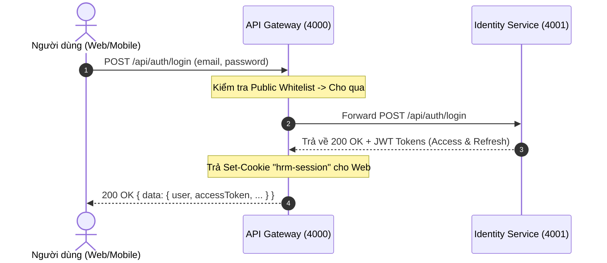

#### Sơ đồ 2: Gọi API Nghiệp vụ được Bảo vệ (Protected Route)

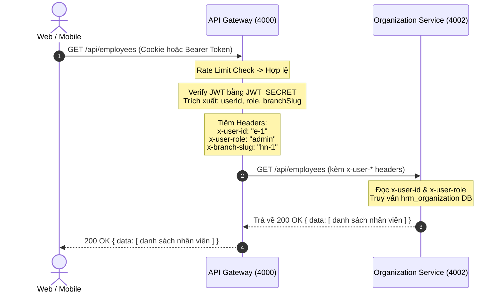

#### Sơ đồ 3: Tích hợp Ngân hàng Chi lương qua SOAP (SOAP Passthrough)

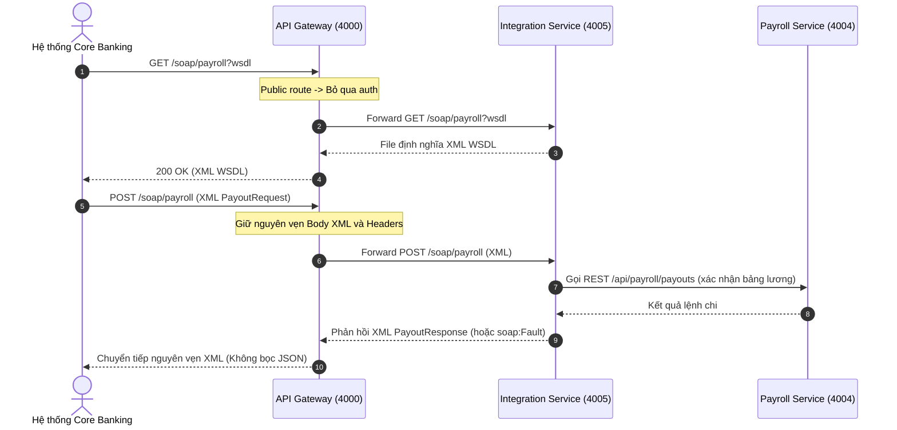

#### Sơ đồ 4: Xử lý Khi Microservice Down (502 Bad Gateway)

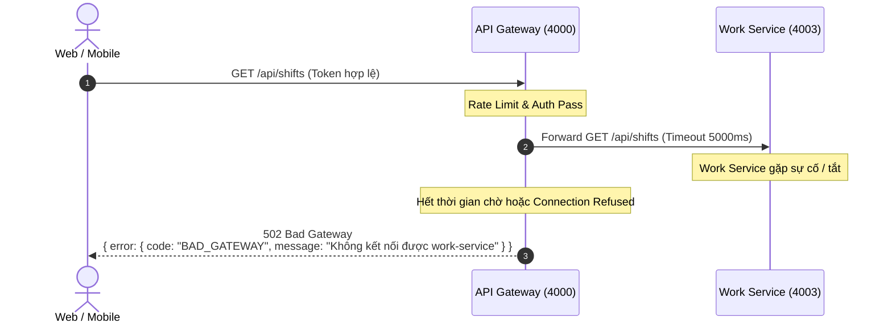

---

### 2.4. Ma trận Phân quyền & Truyền dẫn Danh tính (RBAC Propagation)

| Vai trò (`x-user-role`) | Các nhóm API tiêu biểu được phép truy cập qua Gateway |
|---|---|
| **Admin** | Toàn quyền truy cập mọi tài nguyên: `/api/branches`, `/api/departments`, `/api/employees`, `/api/payroll`, `/api/regulations`, `/api/news`, `/api/wifi-configs`, `/api/soap-config` |
| **Manager** (Quản lý chi nhánh) | Quản lý ca kíp (`/api/shifts`, `/api/tasks`), duyệt đơn từ chi nhánh (`/api/requests`), điểm danh nhân viên (`/api/attendance`), xem bảng tin (`/api/news`) |
| **Staff / Employee** (Nhân viên) | Xem lịch ca cá nhân (`/api/shifts`), đăng ký ca, điểm danh Wi-Fi (`/api/attendance`), gửi đơn xin nghỉ/ứng lương (`/api/requests`), nhận thông báo (`/api/notifications`), xem bảng lương cá nhân (`/api/payroll`) |

*Ghi chú:* API Gateway chỉ đóng vai trò xác thực tính hợp lệ của token và chuyển giao thông tin danh tính (`x-user-*`). Việc cấm/cho phép chi tiết trên từng thao tác nghiệp vụ do Middleware phân quyền (RBAC) tại từng Service nghiệp vụ quyết định.

---

### 2.5. Thông số Cấu hình & Biến Môi trường Gateway (`.env`)

| Tên biến môi trường | Giá trị mặc định | Bắt buộc | Mô tả chi tiết |
|---|---|:---:|---|
| `PORT` | `4000` | Không | Cổng HTTP mà Gateway lắng nghe |
| `SERVICE_NAME` | `api-gateway` | Không | Định danh tên service trong log và healthcheck |
| `CORS_ORIGIN` | `http://localhost:3000` | Có | Danh sách Origin được phép truy cập (phân tách bởi dấu phẩy) |
| `PROXY_TIMEOUT_MS` | `5000` | Không | Thời gian timeout khi proxy sang service đích (mili-giây) |
| `JWT_SECRET` | `dev_only_secret...` | **Có** | Khóa bí mật dùng chung để verify chữ ký JWT (khớp với Identity Service) |
| `COOKIE_NAME` | `hrm-session` | Không | Tên cookie phiên đăng nhập |
| `RATE_LIMIT_WINDOW_MS` | `60000` | Không | Chu kỳ tính lượt giới hạn tần suất (1 phút = 60000ms) |
| `RATE_LIMIT_MAX` | `300` | Không | Số lượng request tối đa cho mỗi IP trong chu kỳ |
| `IDENTITY_URL` | `http://localhost:4001` | **Có** | Địa chỉ máy chủ Identity Service |
| `ORGANIZATION_URL`| `http://localhost:4002` | **Có** | Địa chỉ máy chủ Organization Service |
| `WORK_URL` | `http://localhost:4003` | **Có** | Địa chỉ máy chủ Work Service |
| `PAYROLL_URL` | `http://localhost:4004` | **Có** | Địa chỉ máy chủ Payroll Service |
| `INTEGRATION_URL` | `http://localhost:4005` | **Có** | Địa chỉ máy chủ Integration Service |

---

### 2.6. Danh sách Kiểm thử Tự động & Nghiệm thu (Testing Suite)

Dịch vụ đã được cấu hình bộ kiểm thử tự động với `node:test` bao gồm các ca kiểm thử then chốt:
1. **Kiểm tra Tuyến công khai (`auth.test.js`):** Đảm bảo `POST /api/auth/login` không yêu cầu token và chuyển tiếp thành công.
2. **Kiểm tra Tuyến bảo vệ thiếu token (`auth.test.js`):** Gửi yêu cầu đến `/api/employees` không có token -> Nhận kết quả 401 `UNAUTHORIZED`.
3. **Kiểm tra Token hợp lệ (`auth.test.js`):** Ký token với secret hợp lệ -> Request được gán `req.user.userId`, `req.user.role` chính xác.
4. **Kiểm tra Chặn Refresh Token (`auth.test.js`):** Gửi token có `type === "refresh"` vào route nghiệp vụ -> Bị chặn với mã 401.
5. **Kiểm tra Token giả mạo hoặc sai secret (`auth.test.js`):** Token bị chỉnh sửa hoặc sai chữ ký -> Trả về lỗi 401 `UNAUTHORIZED`.
6. **Kiểm tra Giới hạn tần suất (`ratelimit.test.js`):** Gửi vượt quá số lượng request tối đa trong cửa sổ -> Nhận mã lỗi 429 `RATE_LIMITED`; tuyến `GET /health` không bị giới hạn.
7. **Kiểm tra Healthcheck (`health.test.js`):** `GET /health` trả về đúng định dạng chuẩn `{ "status": "ok", "service": "api-gateway", "time": "..." }`.

---

## 3. DỊCH VỤ 2: IDENTITY SERVICE (`backend/identity-service` - Port 4001)

### 3.1. Tổng quan & Vai trò
- **Cổng dịch vụ (Port):** `4001` (`http://localhost:4001`).
- **Database:** Sở hữu cơ sở dữ liệu `hrm_identity` (PostgreSQL qua Prisma ORM).
- **Nhiệm vụ trọng tâm:**
  1. Là Nhà cung cấp danh tính (Identity Provider - IdP) trung tâm của toàn hệ sinh thái HRM Enterprise.
  2. Quản lý thông tin tài khoản người dùng, mã hóa mật khẩu bảo mật một chiều bằng thuật toán `bcryptjs`.
  3. Cấp phát và ký số JSON Web Tokens: Access Token (15 phút) và Refresh Token (7 ngày).
  4. Quản lý trạng thái phiên đăng nhập và danh sách thiết bị truy cập (Device Tracking & Multi-device Management).
  5. Xử lý chu trình tài khoản: Đổi mật khẩu, quên mật khẩu (đưa về mật khẩu mặc định `123456`).
  6. Cơ chế Dual-mode / In-memory Fallback: Sẵn sàng hoạt động ngay cả khi chưa kết nối PostgreSQL, phục vụ kiểm thử và đảm bảo mốc kiểm tra sức khỏe `GET /health` luôn thông suốt.

```
                  ┌──────────────────────────────┐
                  │ API Gateway (Port 4000)      │
                  └──────────────┬───────────────┘
                                 │
                   Forward /api/auth/* requests
                                 │
                                 ▼
         ═════════════════════════════════════════════════
         ║   IDENTITY SERVICE (Port 4001)                ║
         ║   - Controller: AuthController.js             ║
         ║   - Validator:  authValidator.js              ║
         ║   - Service:    AuthService.js                ║
         ║   - Domain:     User Entity (Rules check)     ║
         ║   - Crypto:     bcryptjs (10 rounds) + JWT    ║
         ║   - Repos:      UserRepository & DeviceRepo   ║
         ═════════════════════════════════════════════════
                                 │
                   ┌─────────────┴─────────────┐
                   ▼                           ▼
        ┌─────────────────────┐     ┌─────────────────────┐
        │  PostgreSQL DB      │     │ In-Memory Fallback  │
        │  (hrm_identity)     │     │ (Local Memory Seed) │
        └─────────────────────┘     └─────────────────────┘
```

### 3.2. Mô hình Dữ liệu & Thiết kế Domain (Data Schema & Domain Logic)

#### 1. Cấu trúc Bảng `users` trong CSDL `hrm_identity`
Mô hình định nghĩa trong [prisma/schema.prisma](file:///d:/Code/DuAn/PTPMDV/backend/identity-service/prisma/schema.prisma):
```prisma
model User {
  id           String   @id @default(cuid())
  email        String   @unique
  passwordHash String
  name         String
  role         String   @default("staff") // admin | manager | staff
  roleTitle    String   @default("Nhân viên")
  branchSlug   String?
  createdAt    DateTime @default(now())
  updatedAt    DateTime @updatedAt

  @@map("users")
}
```

#### 2. Thực thể Nghiệp vụ Domain `User` ([User.js](file:///d:/Code/DuAn/PTPMDV/backend/identity-service/src/domain/entities/User.js))
- Đóng gói các quy tắc toàn vẹn dữ liệu:
  * `email`: Bắt buộc, không được để trống và phải có định dạng chứa ký tự `@`.
  * `role`: Bắt buộc phải thuộc danh sách hợp lệ: `ALLOWED_ROLES = ["admin", "manager", "staff"]`. Nếu truyền sai (như `boss`, `guest`), thực thể ném lỗi `VALIDATION_ERROR` (HTTP 400).
  * Phương thức `toJSON()`: Tự động loại bỏ trường nhạy cảm `passwordHash` khi serialize dữ liệu gửi về Client.

#### 3. Mô hình Quản lý Thiết bị ([DeviceRepository.js](file:///d:/Code/DuAn/PTPMDV/backend/identity-service/src/infrastructure/database/repositories/DeviceRepository.js))
Theo dõi chi tiết các phiên làm việc của người dùng trên nhiều thiết bị:
- `id`: Mã thiết bị định danh (`dev-01`, `dev-02`...).
- `deviceName`: Tên thiết bị hiển thị (Tự động nhận diện từ User-Agent: iPhone 15 Pro Max, iPad Pro 11", Samsung Galaxy S24, MacBook Pro, Windows PC, hoặc nạp từ header `x-device-name`).
- `deviceType`: `phone` | `tablet` | `desktop`.
- `osInfo`: Chi tiết hệ điều hành (iOS 18.0, Android 14, Windows 11...).
- `location`: Vị trí đăng nhập (mặc định định vị chi nhánh: "Hà Nội, Việt Nam").
- `ipAddress`: Địa chỉ IP thiết bị (trích xuất từ `x-forwarded-for` hoặc socket connection).
- `lastActive`: Trạng thái hoạt động ("Đang hoạt động", "2 giờ trước",...).
- `isCurrent`: Đánh dấu phiên hiện tại đang gửi request.

#### 4. Dữ liệu Hạt giống Mặc định (Seed Data)
Hệ thống tự động kích hoạt hàm `ensureSeeded()` khi khởi động server:
- Tài khoản Quản trị viên Tối cao (Admin):
  * `id`: `NV-0001`
  * `email`: `admin@company.com`
  * `name`: `Trần Minh Tuấn`
  * `password`: `123456` (Mã hóa bcrypt 10 rounds)
  * `role`: `admin`
  * `roleTitle`: `Quản trị viên`
  * `branchSlug`: `null` (Toàn quyền trên mọi chi nhánh)

---

### 3.3. Đặc tả Chi tiết các Chức năng Nghiệp vụ (Use Cases & Endpoints)

#### 1. Đăng nhập Hệ thống (`POST /api/auth/login`)
- **Quyền:** Công khai (Public).
- **Dữ liệu đầu vào (Body):**
  ```json
  {
    "email": "admin@company.com",
    "password": "123456"
  }
  ```
- **Quy tắc Kiểm tra tính hợp lệ (Validation):**
  - `email`: Bắt buộc, chuỗi văn bản có chứa ký tự `@`.
  - `password`: Bắt buộc, độ dài tối thiểu từ 4 ký tự.
- **Quy trình Xử lý Nghiệp vụ:**
  1. Chuẩn hóa email: `email.toLowerCase().trim()`.
  2. Tìm kiếm người dùng trong cơ sở dữ liệu `hrm_identity` (hoặc kho in-memory).
  3. So sánh mật khẩu bằng `bcrypt.compare(password, row.passwordHash)`.
  4. Nếu không tìm thấy email hoặc sai mật khẩu: Trả về HTTP `401 Unauthorized` với thông điệp trung hòa: *"Email hoặc mật khẩu không đúng"* (Bảo mật: ngăn chặn kỹ thuật dò quét tài khoản).
  5. Khởi tạo đối tượng Domain `User`.
  6. Tự động ghi nhận/cập nhật thông tin thiết bị truy cập vào `DeviceRepository` qua `parseClientInfo(req)`.
  7. Sinh cặp JSON Web Token:
     - `accessToken`: Hạn 15 phút, payload `{ userId, email, role, branchSlug }`.
     - `refreshToken`: Hạn 7 ngày, payload `{ userId, email, role, branchSlug, type: "refresh" }`.
  8. Gắn Cookie `hrm-session` vào Response Header: `httpOnly: true`, `sameSite: "lax"`, `path: "/"`, `maxAge: 7 ngày`.
- **Dữ liệu phản hồi chuẩn (Response):**
  ```json
  {
    "data": {
      "user": {
        "id": "NV-0001",
        "email": "admin@company.com",
        "name": "Trần Minh Tuấn",
        "role": "admin",
        "roleTitle": "Quản trị viên",
        "branchSlug": null
      },
      "accessToken": "eyJhbGciOi...",
      "refreshToken": "eyJhbGciOi..."
    },
    "message": "Đăng nhập thành công"
  }
  ```

#### 2. Lấy thông tin tài khoản hiện tại (`GET /api/auth/me`)
- **Quyền:** Yêu cầu đăng nhập (Protected via `sessionMiddleware`).
- **Quy trình Xử lý:**
  1. Trích xuất token từ Cookie `hrm-session` hoặc Header `Authorization: Bearer <token>`.
  2. Giải mã và kiểm tra chữ ký token. Nếu hết hạn, trả về HTTP `401` ("Phiên đăng nhập hết hạn").
  3. Lấy `userId` từ token payload, truy vấn cơ sở dữ liệu.
  4. Trả về thông tin hồ sơ `User` sạch không chứa mật khẩu băm.

#### 3. Đăng xuất Khỏi Hệ thống (`POST /api/auth/logout`)
- **Quyền:** Công khai.
- **Quy trình Xử lý:**
  1. Gọi lệnh xóa cookie: `res.clearCookie("hrm-session", { path: "/" })`.
  2. Phản hồi HTTP 200: `{ "data": { "ok": true }, "message": "Đăng xuất thành công" }`.

#### 4. Cấp lại Access Token (`POST /api/auth/refresh`)
- **Quyền:** Công khai.
- **Dữ liệu đầu vào:** Trường `refreshToken` trong Body hoặc Header `x-refresh-token`.
- **Quy trình Xử lý:**
  1. Nếu thiếu token: Báo lỗi `400 VALIDATION_ERROR` ("Thiếu refresh token").
  2. Xác minh chữ ký token. Nếu token hết hạn hoặc sai chữ ký: Trả về HTTP `401` ("Refresh token không hợp lệ hoặc đã hết hạn").
  3. Kiểm tra tính chất token: Bắt buộc `payload.type === "refresh"`. Nếu là Access Token thường đưa vào: Trả về HTTP `401` ("Token cung cấp không phải là refresh token").
  4. Kiểm tra tài khoản trong DB để đảm bảo người dùng chưa bị xóa/khóa.
  5. Cấp cặp Access Token mới (15m) và Refresh Token mới (7d), cập nhật lại cookie `hrm-session`.

#### 5. Đổi Mật khẩu Chủ động (`POST /api/auth/change-password`)
- **Quyền:** Yêu cầu đăng nhập (Protected).
- **Dữ liệu đầu vào:**
  ```json
  {
    "currentPassword": "password_cu",
    "newPassword": "password_moi"
  }
  ```
- **Quy tắc Kiểm tra tính hợp lệ:**
  - `currentPassword`: Bắt buộc.
  - `newPassword`: Bắt buộc, độ dài tối thiểu từ **6 ký tự** trở lên.
- **Quy trình Xử lý:**
  1. Truy vấn mật khẩu băm hiện tại của tài khoản từ `userId` trong phiên.
  2. So sánh `currentPassword` với mật khẩu hiện tại bằng `bcrypt.compare`. Nếu không khớp, trả về HTTP `400` ("Mật khẩu hiện tại không chính xác").
  3. Băm mật khẩu mới bằng `bcrypt.hash(newPassword, 10)`.
  4. Cập nhật trường `passwordHash` vào CSDL `hrm_identity`.
  5. Phản hồi: `{ "data": { "ok": true }, "message": "Đổi mật khẩu thành công" }`.

#### 6. Khôi phục Mật khẩu Mặc định (`POST /api/auth/forgot-password`)
- **Quyền:** Công khai.
- **Dữ liệu đầu vào:** `{ "email": "admin@company.com" }`.
- **Quy định Nghiệp vụ:**
  1. Kiểm tra tính hợp lệ của email.
  2. Truy vấn tài khoản theo email trong DB. Nếu không tìm thấy, trả về HTTP `404 NOT_FOUND` ("Không tìm thấy tài khoản với email này trên hệ thống").
  3. Đặt lại mật khẩu tài khoản về mật khẩu chuẩn mặc định toàn dự án là **`123456`**.
  4. Băm bằng `bcrypt.hash("123456", 10)` và lưu lại vào DB.
  5. Phản hồi HTTP 200:
     ```json
     {
       "data": { "ok": true, "reset": true, "defaultPassword": "123456" },
       "message": "Mật khẩu đã được đặt lại về 123456"
     }
     ```

#### 7. Quản lý Phiên Thiết bị (`GET /api/auth/devices` & `DELETE /api/auth/devices/:id`)
- **Xem danh sách thiết bị (`GET /api/auth/devices`):**
  - Trả về toàn bộ các thiết bị mà người dùng đã từng đăng nhập kèm thông tin trạng thái hoạt động, IP, và cờ `isCurrent` để người dùng kiểm tra phiên đang dùng.
- **Gỡ thiết bị / Hủy phiên từ xa (`DELETE /api/auth/devices/:id`):**
  - Cho phép người dùng chủ động ngắt quyền truy cập của một thiết bị cụ thể (ví dụ: bị mất điện thoại, quên đăng xuất tại máy công cộng).

---

### 3.4. Sơ đồ Luồng Nghiệp vụ (Sequence Diagrams)

#### Sơ đồ 1: Luồng Đăng nhập & Khởi tạo Phiên Đa nền tảng

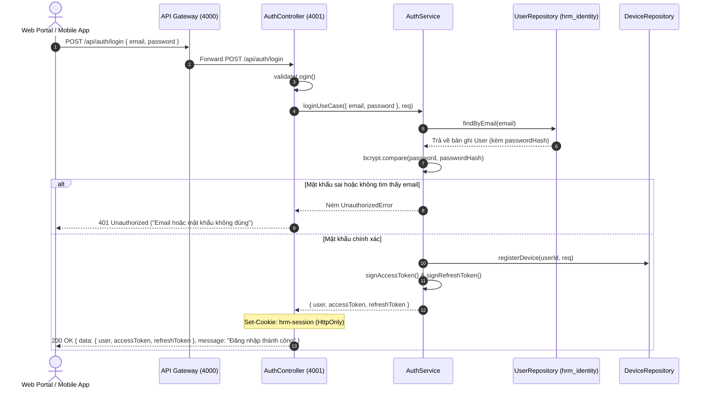

#### Sơ đồ 2: Luồng Cấp lại Token (Refresh Token Workflow)

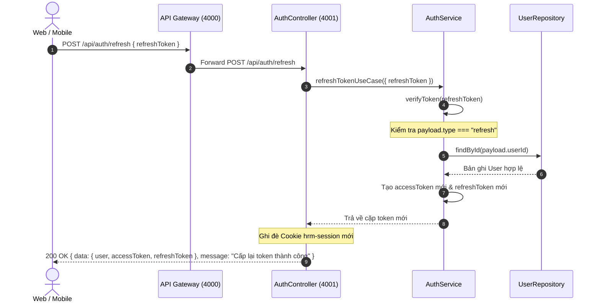

---

### 3.5. Cấu hình Môi trường của Identity Service (`.env`)

| Biến môi trường | Giá trị mặc định | Bắt buộc | Mô tả chức năng |
|---|---|:---:|---|
| `PORT` | `4001` | Không | Cổng dịch vụ lắng nghe |
| `SERVICE_NAME` | `identity-service` | Không | Tên dịch vụ hiển thị trong healthcheck và logs |
| `NODE_ENV` | `development` | Không | Môi trường chạy (`development` / `production`) |
| `DATABASE_URL` | `postgresql://...` | **Có** (cho DB thật) | Chuỗi kết nối tới CSDL `hrm_identity` trên Supabase |
| `JWT_SECRET` | Khóa bí mật (≥ 32 ký tự) | **Có** | Khóa ký số JWT (Dùng chung đồng bộ với Gateway) |
| `JWT_EXPIRES_IN` | `15m` | Không | Thời hạn sống của Access Token |
| `JWT_REFRESH_EXPIRES_IN` | `7d` | Không | Thời hạn sống của Refresh Token |
| `CORS_ORIGIN` | `http://localhost:3000` | Có | Nguồn gốc hợp lệ cho phép cookie credentials |

---

### 3.6. Bảng Tổng hợp Bộ Kiểm thử Tự động (Testing Suite)

Dịch vụ sở hữu bộ kiểm thử tự động toàn diện qua thư viện chuẩn `node:test`, đạt tỉ lệ vượt qua 100%:

1. **Kiểm thử Đơn vị (`tests/unit/auth.test.js`):**
   - Kiểm tra `validateLogin`: Bắt buộc từ chối request body rỗng hoặc thiếu trường.
   - Kiểm tra `validateChangePassword`: Từ chối mật khẩu mới ngắn hơn 6 ký tự.
   - Kiểm tra `validateForgotPassword`: Từ chối email sai định dạng, chấp nhận email hợp lệ.
   - Kiểm tra Entity `User`: Ném ngoại lệ khi khởi tạo với vai trò nằm ngoài danh sách (`boss`, `guest`,...).
2. **Kiểm thử Tích hợp (`tests/integration/account.test.js`):**
   - Đăng nhập lấy phiên cookie và refresh token thật.
   - Kiểm thử endpoint `POST /api/auth/refresh`: Cấp lại token thành công.
   - Kiểm thử endpoint `GET /api/auth/devices`: Trả về mảng danh sách thiết bị kèm thông số đầy đủ.
   - Kiểm thử endpoint `DELETE /api/auth/devices/:id`: Gỡ bỏ thiết bị thành công (`removed: true`).
   - Kiểm thử endpoint `POST /api/auth/forgot-password`: Đặt lại mật khẩu về `123456` thành công.
   - Kiểm thử endpoint `POST /api/auth/change-password`: Đổi mật khẩu mới và hoàn trả mật khẩu gốc thành công.
3. **Kiểm thử Kiểm tra Sức khỏe (`tests/integration/health.test.js`):**
   - `GET /health` trả về HTTP 200 với envelope chuẩn `{ status: "ok", service: "identity-service", time: "..." }`.

---

## 4. DỊCH VỤ 3: ORGANIZATION SERVICE (`backend/organization-service` - Port 4002)

### 4.1. Tổng quan & Vai trò
- **Cổng dịch vụ (Port):** `4002` (`http://localhost:4002`).
- **Thành viên phụ trách:** B (nhánh `feat/organization-employees`).
- **Cơ sở dữ liệu:** `hrm_organization` (PostgreSQL độc lập qua Prisma ORM).
- **Nhiệm vụ trọng tâm trong kiến trúc SOA:**
  1. Là **Nguồn dữ liệu chân thực duy nhất (Single Source of Truth - SSOT)** về Cơ cấu tổ chức (Chi nhánh, Phòng ban) và Danh bạ nhân sự (Hồ sơ nhân viên, hợp đồng, mức lương, số tài khoản ngân hàng).
  2. Cung cấp dữ liệu nền tảng cho toàn bộ hệ thống:
     * `work-service` (Port 4003): Tham chiếu danh sách nhân viên (`employeeId`) và chi nhánh (`branchSlug`) để xếp ca, đăng ký ca, điểm danh và giao nhiệm vụ.
     * `payroll-service` (Port 4004): Truy vấn HTTP nội bộ (`GET /api/employees/:id`) để lấy `baseSalary`, `salaryType`, `hourlySalary` và thông tin tài khoản ngân hàng (`bankName`, `bankAccountNumber`, `bankAccountName`) nhằm tính lương và lập lệnh chi.
     * `integration-service` (Port 4005): Quản lý Wi-Fi chi nhánh, đơn từ xin nghỉ phép của nhân sự, thông báo bảng tin.
  3. **Cơ chế Dual-mode (Postgres + In-memory Fallback):** Có khả năng hoạt động ở chế độ in-memory nếu chưa cấu hình `DATABASE_URL` hoặc Prisma client chưa generate, đảm bảo service luôn khởi động độc lập và pass `GET /health`.

```
                  ┌──────────────────────────────┐
                  │ API Gateway (Port 4000)      │
                  └──────────────┬───────────────┘
                                 │
                   Forward /api/{branches, departments, employees}
                                 │
                                 ▼
         ═════════════════════════════════════════════════
         ║   ORGANIZATION SERVICE (Port 4002)            ║
         ║   - Controller: OrgController.js              ║
         ║   - Validator:  orgValidator.js               ║
         ║   - Service:    OrgService.js                 ║
         ║   - Repos:      BranchRepo, DepartmentRepo,   ║
         ║                 EmployeeRepository            ║
         ═════════════════════════════════════════════════
                                 │
                   ┌─────────────┴─────────────┐
                   ▼                           ▼
        ┌─────────────────────┐     ┌─────────────────────┐
        │  PostgreSQL DB      │     │ In-Memory Fallback  │
        │ (hrm_organization)  │     │ (Local Memory Seed) │
        └─────────────────────┘     └─────────────────────┘
```

### 4.2. Mô hình Dữ liệu & Lược đồ CSDL (`hrm_organization`)

#### 1. Bảng Chi nhánh (`branches` - Prisma Model `Branch`)
> Mã chi nhánh (`slug`) do hệ thống tự sinh dạng `CN-0001` (tăng dần), client không tự nhập.

```prisma
model Branch {
  id        String   @id @default(cuid())
  name      String
  slug      String   @unique
  address   String?
  manager   String?
  status    String   @default("hoạt động")
  staff     Int      @default(0)
  createdAt DateTime @default(now())
  updatedAt DateTime @updatedAt

  @@map("branches")
}
```

#### 2. Bảng Phòng ban (`departments` - Prisma Model `Department`)
> Mã phòng ban (`code`) do hệ thống tự sinh dạng `PB-0001` (tăng dần), client không tự nhập.

```prisma
model Department {
  id          String   @id @default(cuid())
  name        String
  code        String   @unique
  description String?
  manager     String?
  status      String   @default("hoạt động")
  staff       Int      @default(0)
  createdAt   DateTime @default(now())
  updatedAt   DateTime @updatedAt

  @@map("departments")
}
```

#### 3. Bảng Hồ sơ Nhân sự (`employees` - Prisma Model `Employee`)
> Mã nhân viên (`id`) do hệ thống tự sinh dạng `NV-0001` (tăng dần), client không tự nhập.

```prisma
model Employee {
  id                String   @id @default(cuid())
  name              String
  email             String   @unique
  phone             String?
  gender            String?
  birthDate         String?
  province          String?
  ward              String?
  street            String?
  cccd              String?
  issueDate         String?
  issuePlace        String?
  cccdFront         String?
  cccdBack          String?
  branchSlug        String?
  department        String?
  role              String?
  systemRole        String   @default("staff") // admin | manager | staff
  status            String   @default("đang làm") // đang làm | resigned
  joinDate          String?
  baseSalary        Float    @default(0)
  salaryType        String   @default("monthly") // monthly | hourly
  hourlySalary      Float?
  bankName          String?
  bankAccountNumber String?
  bankAccountName   String?
  createdAt         DateTime @default(now())
  updatedAt         DateTime @updatedAt

  @@map("employees")
}
```

#### 4. Dữ liệu Hạt giống Mặc định (Seed Data)
Hệ thống tự động kích hoạt `ensureSeeded()` khi khởi động server:
- Tự động đồng bộ tài khoản Quản trị viên tối cao:
  * `id`: `NV-0001`
  * `name`: `Trần Minh Tuấn`
  * `email`: `admin@company.com`
  * `role`: `Quản trị viên`
  * `systemRole`: `admin`
  * `status`: `đang làm`
  * `joinDate`: `01-01-2024`
  * `baseSalary`: `20,000,000 VND`
  * `salaryType`: `monthly`

---

### 4.3. Đặc tả Chi tiết các Chức năng Nghiệp vụ & API Endpoints

#### 1. Quản lý Chi nhánh (Branches API)
| Method | Đường dẫn | Chức năng nghiệp vụ & Quy tắc kiểm tra | Mã phản hồi |
|---|---|---|:---:|
| `GET` | `/api/branches` | Lấy danh sách toàn bộ chi nhánh (sắp xếp tăng dần theo `slug`). | `200` |
| `GET` | `/api/branches/:slug` | Lấy thông tin chi tiết 1 chi nhánh theo slug. Nếu không tồn tại ném lỗi `NOT_FOUND`. | `200` / `404` |
| `POST` | `/api/branches` | Thêm mới chi nhánh.<br/>- Bắt buộc: `name`, `slug`.<br/>- Kiểm tra trùng: Trùng `slug` trả về `DUPLICATE_RESOURCE`. | `201` / `400` / `409` |
| `PUT` | `/api/branches/:slug` | Cập nhật thông tin chi nhánh (tên, địa chỉ, hotline, quản lý, trạng thái). | `200` / `404` |
| `DELETE` | `/api/branches/:slug` | Xóa bỏ chi nhánh khỏi hệ thống. | `200` / `404` |

#### 2. Quản lý Phòng ban (Departments API)
| Method | Đường dẫn | Chức năng nghiệp vụ & Quy tắc kiểm tra | Mã phản hồi |
|---|---|---|:---:|
| `GET` | `/api/departments` | Lấy danh sách toàn bộ phòng ban (sắp xếp tăng dần theo `code`). | `200` |
| `GET` | `/api/departments/:id` | Lấy thông tin chi tiết phòng ban theo ID. Nếu không có ném lỗi `NOT_FOUND`. | `200` / `404` |
| `POST` | `/api/departments` | Tạo phòng ban mới.<br/>- Bắt buộc: `name`, `code`.<br/>- Kiểm tra trùng: Trùng `code` trả về `DUPLICATE_RESOURCE`. | `201` / `400` / `409` |
| `PUT` | `/api/departments/:id` | Cập nhật phòng ban (tên, mô tả, quản lý, trạng thái). | `200` / `404` |
| `DELETE` | `/api/departments/:id` | Xóa bỏ phòng ban khỏi hệ thống. | `200` / `404` |

#### 3. Quản lý Nhân sự (Employees API)
| Method | Đường dẫn | Chức năng nghiệp vụ & Quy tắc kiểm tra | Mã phản hồi |
|---|---|---|:---:|
| `GET` | `/api/employees` | Lấy danh sách nhân viên có hỗ trợ các bộ lọc Query params:<br/>- `?branchSlug=hn-1`: Lọc theo chi nhánh.<br/>- `?department=` hoặc `?departmentId=`: Lọc theo phòng ban.<br/>- `?systemRole=staff`: Lọc theo vai trò hệ thống (`admin`, `manager`, `staff`). | `200` |
| `GET` | `/api/employees/:id` | Lấy chi tiết hồ sơ nhân sự theo ID (phục vụ xem hồ sơ, hoặc `payroll-service` gọi nội bộ để lấy mức lương và tài khoản ngân hàng). Nếu không tìm thấy ném lỗi mã `EMPLOYEE_NOT_FOUND`. | `200` / `404` |
| `POST` | `/api/employees` | Thêm mới nhân sự.<br/>- Bắt buộc: `name`, `email` hợp lệ.<br/>- Ràng buộc: `systemRole` chỉ nhận `admin`, `manager`, hoặc `staff`. Sai giá trị ném `VALIDATION_ERROR` (400).<br/>- Kiểm tra trùng: Trùng email trả về `DUPLICATE_RESOURCE` (409).<br/>- Khởi tạo ngầm định: `status: "đang làm"`, `salaryType: "monthly"`, `baseSalary: 0`. | `201` / `400` / `409` |
| `PUT` | `/api/employees/:id` | Cập nhật thông tin nhân viên (hồ sơ cá nhân, CCCD, phân bổ chi nhánh, phòng ban, vai trò, mức lương, tài khoản ngân hàng). Validate email và `systemRole` nếu có cập nhật. | `200` / `400` / `404` |
| `POST` | `/api/employees/:id/leave` | Xác nhận nhân viên thôi việc.<br/>- Chuyển `status` thành `"resigned"`.<br/>- Ghi nhận trường `resignedAt` thời điểm hiện tại. | `200` / `404` |
| `DELETE` | `/api/employees/:id` | Xóa hồ sơ nhân viên khỏi hệ thống. | `200` / `404` |

#### 4. Kiểm tra Sức khỏe (Healthcheck)
- `GET /health` trả về HTTP 200: `{ "status": "ok", "service": "organization-service", "time": "..." }`.

---

### 4.4. Sơ đồ Luồng Tích hợp & Tương tác Liên Dịch vụ

#### Sơ đồ 1: Thêm mới Hồ sơ Nhân sự từ Web Portal qua Gateway

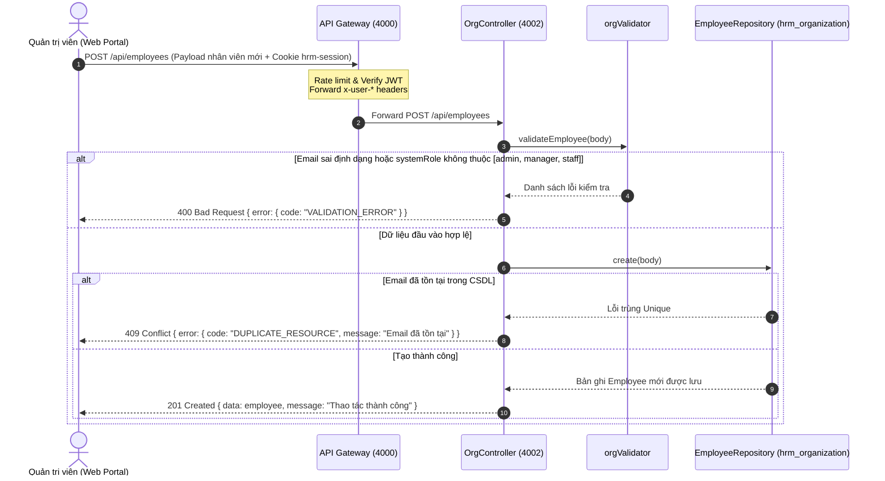

#### Sơ đồ 2: Payroll Service Gọi Nội bộ Lấy Mức lương & Ngân hàng để Lập Bảng lương

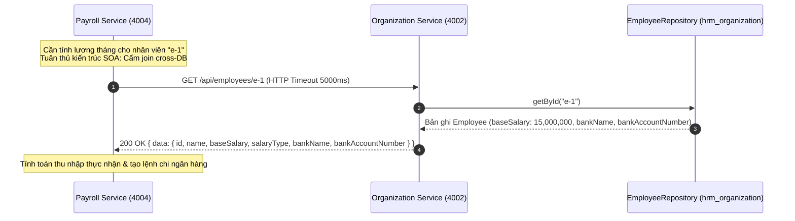

---

### 4.5. Bảng Biến Môi trường Cấu hình (`.env`)

| Biến môi trường | Giá trị mặc định | Bắt buộc | Mô tả chức năng |
|---|---|:---:|---|
| `PORT` | `4002` | Không | Cổng dịch vụ lắng nghe |
| `SERVICE_NAME` | `organization-service` | Không | Tên dịch vụ hiển thị trong healthcheck và logs |
| `NODE_ENV` | `development` | Không | Môi trường triển khai (`development` / `production`) |
| `DATABASE_URL` | `postgresql://...` | **Có** (cho DB thật) | Chuỗi kết nối tới CSDL `hrm_organization` trên Supabase |
| `CORS_ORIGIN` | `http://localhost:3000` | Có | Danh sách Origin được phép truy cập |

---

### 4.6. Danh sách Kiểm thử Tự động (Testing Suite)

Dịch vụ đã được cấu hình và chạy kiểm thử tự động với `node:test`:

1. **Kiểm thử Đơn vị (`tests/unit/org.test.js`):**
   - Kiểm tra `validateEmployee`:
     * Chấp nhận payload hợp lệ với `systemRole: "staff"`.
     * Từ chối và ném lỗi khi `systemRole: "boss"` (không nằm trong danh sách `["admin", "manager", "staff"]`).
2. **Kiểm thử Tích hợp (`tests/integration/org.test.js`):**
   - `GET /api/branches`: Trả về danh sách chi nhánh (mảng >= 3 chi nhánh mặc định).
   - `GET /api/employees?systemRole=staff`: Lọc chính xác danh sách nhân viên có vai trò `staff`.
   - Bắt lỗi trùng email khi tạo mới (`POST /api/employees` trùng `admin@company.com`): Trả về HTTP 409 `DUPLICATE_RESOURCE`.
   - Bắt lỗi vai trò hệ thống không hợp lệ (`POST /api/employees` với `systemRole: "boss"`): Trả về HTTP 400 `VALIDATION_ERROR`.
3. **Kiểm thử Kiểm tra Sức khỏe (`tests/integration/health.test.js`):**
   - `GET /health`: Trả về HTTP 200 với envelope chuẩn `{ status: "ok", service: "organization-service", time: "..." }`.

---

## 5. DỊCH VỤ 4: PAYROLL SERVICE (`backend/payroll-service` - Port 4004)

### 5.1. Tổng quan & Vai trò
- **Cổng dịch vụ (Port):** `4004` (`http://localhost:4004`).
- **Thành viên phụ trách:** D (nhánh `feat/payroll-payouts`).
- **Cơ sở dữ liệu:** `hrm_payroll` (PostgreSQL độc lập qua Prisma ORM).
- **Nhiệm vụ trọng tâm trong kiến trúc SOA:**
  1. **Quản lý Tài khoản Ngân hàng Doanh nghiệp (`bank_accounts`):** Lưu trữ tài khoản ngân hàng nguồn của công ty dùng để trích nợ khi chi lương; kiểm soát số dư và đảm bảo chỉ có duy nhất 1 tài khoản mặc định (`isPrimary: true`).
  2. **Xử lý Lệnh Chi Lương Chống Trùng (REST Idempotent Payout - `payouts`):**
     * Nhận yêu cầu tạo lệnh chi lương kèm khóa chống trùng `idempotencyKey`.
     * Sinh mã giao dịch nội bộ `id: TXN-xxxxxx` và mã đối soát ngân hàng `bankReference: BANK-xxxxxxxx`.
     * Kiểm tra số dư tài khoản công ty: Nếu số dư nhỏ hơn tổng số tiền chi, trả về HTTP **422 Unprocessable Entity** với mã lỗi `INSUFFICIENT_FUNDS`.
     * Trừ trực tiếp số dư tài khoản trích nợ khi tạo lệnh chi thành công.
     * **Cơ chế Idempotent:** Khi Client hoặc Gateway gửi lại yêu cầu với `idempotencyKey` đã tồn tại, hệ thống trả về bản ghi giao dịch cũ kèm cờ `deduped: true` và HTTP Status `200 OK`, tuyệt đối **không trừ tiền lần thứ hai**.
  3. **Tổng hợp & Quản lý Phiếu Lương (`payslips`):**
     * Công thức tính lương thực nhận: `netSalary = baseSalary + bonus - totalPenalty`.
     * Khóa duy nhất chống trùng: `@@unique([employeeId, month])` ngăn chặn việc tạo trùng phiếu lương của một nhân viên trong cùng một tháng (định dạng tháng `MM-YYYY`).
     * **Tích hợp Tự động Liên Microservice (Cross-service Auto-fetch):**
       - Khi `autoFetch: true`: Tự động gọi HTTP sang `organization-service` (`GET /api/employees/:id`) qua `OrgClient` (timeout 5000ms) để lấy mức lương cơ bản `baseSalary`.
       - Khi `sumPenalty: true`: Tự động gọi HTTP sang `work-service` (`GET /api/attendance?employeeId=&month=YYYY-MM`) qua `WorkClient` (timeout 5000ms) để cộng dồn toàn bộ tiền phạt chấm công `penaltyAmount` trong tháng.
     * Hỗ trợ điều chỉnh thưởng/phạt thủ công và tự động tính toán lại `netSalary`.
     * Hỗ trợ quy trình chốt phiếu lương hàng loạt (`status`: `"chưa chốt"` -> `"đã chốt"`).
  4. **Quy định Nghiệp vụ Chi trả Tiền lương (Banking Integration Protocol):**
     * Khi tiền được chuyển từ tài khoản công ty sang tài khoản nhân viên, hệ thống **không gửi push notification về mobile** cho nhân viên. Nhân viên sẽ tự tra cứu và nhận thông báo biến động số dư qua SMS Banking hoặc ứng dụng của ngân hàng.
     * Thông báo chung về việc hoàn tất chi lương toàn công ty sẽ do Admin/Manager đăng tải tại Bảng tin (`integration-service`).
  5. **Cơ chế Dual-mode (PostgreSQL + In-memory Fallback):** Sẵn sàng hoạt động ở chế độ in-memory nếu chưa nạp `DATABASE_URL`, đảm bảo mốc kiểm tra sức khỏe `GET /health` luôn thông suốt.

```
                  ┌──────────────────────────────┐
                  │ API Gateway (Port 4000)      │
                  └──────────────┬───────────────┘
                                 │
                   Forward /api/payroll/* requests
                                 │
                                 ▼
         ═════════════════════════════════════════════════
         ║   PAYROLL SERVICE (Port 4004)                 ║
         ║   - Controller: PayrollController.js          ║
         ║   - Validator:  payrollValidator.js           ║
         ║   - Service:    PayrollService.js             ║
         ║   - Repository: PayrollRepository.js          ║
         ║   - External:   OrgClient, WorkClient         ║
         ═════════════════════════════════════════════════
               │                 │                 │
      HTTP Timeout 5000ms  HTTP Timeout 5000ms     ▼
               │                 │      ┌─────────────────────┐
               ▼                 ▼      │ PostgreSQL DB       │
       ┌──────────────┐   ┌───────────┐ │ (hrm_payroll)       │
       │ 4002: Organ. │   │ 4003: Work│ ├─────────────────────┤
       │ (baseSalary) │   │ (penalties│ │ In-Memory Fallback  │
       └──────────────┘   └───────────┘ └─────────────────────┘
```

### 5.2. Mô hình Dữ liệu & Lược đồ CSDL (`hrm_payroll`)

#### 1. Bảng Tài khoản Ngân hàng Công ty (`bank_accounts` - Prisma Model `BankAccount`)
```prisma
model BankAccount {
  id            String   @id @default(cuid())
  accountNumber String   @unique
  accountName   String?
  bankName      String?
  balance       Float    @default(0)
  status        String   @default("hoạt động")
  isPrimary     Boolean  @default(false)
  createdAt     DateTime @default(now())
  updatedAt     DateTime @updatedAt

  @@map("bank_accounts")
}
```
*Quy tắc nghiệp vụ:* Trong toàn bộ bảng `bank_accounts`, chỉ cho phép **tối đa duy nhất 1 tài khoản** có `isPrimary = true`. Khi tạo hoặc cập nhật một tài khoản thành `isPrimary: true`, hệ thống tự động cập nhật tất cả các tài khoản khác về `isPrimary: false`.

#### 2. Bảng Lệnh Chi Lương (`payouts` - Prisma Model `Payout`)
```prisma
model Payout {
  id               String   @id // Format: TXN-xxxxxx
  bankReference    String   @unique // Format: BANK-xxxxxxxx
  debitAccount     String
  totalAmount      Float
  content          String?
  beneficiaryCount Int      @default(0)
  idempotencyKey   String   @unique
  status           String   @default("pending") // pending | success | failed
  createdAt        DateTime @default(now())

  @@map("payouts")
}
```

#### 3. Bảng Phiếu Lương Nhân viên (`payslips` - Prisma Model `Payslip`)
```prisma
model Payslip {
  id           String   @id @default(cuid()) // Format: ps-xxxxxx
  employeeId   String
  month        String   // Định dạng: MM-YYYY (ví dụ: 10-2026)
  baseSalary   Float    @default(0)
  bonus        Float    @default(0)
  totalPenalty Float    @default(0)
  netSalary    Float    @default(0) // baseSalary + bonus - totalPenalty
  payoutId     String?  // Tham chiếu tới Payout.id
  status       String   @default("chưa chốt") // chưa chốt | đã chốt
  issuedAt     DateTime @default(now())

  @@unique([employeeId, month])
  @@map("payslips")
}
```

---

### 5.3. Đặc tả Chi tiết các Chức năng Nghiệp vụ & API Endpoints

#### 1. Quản lý Tài khoản Ngân hàng Doanh nghiệp
| Method | Đường dẫn | Chức năng nghiệp vụ & Quy tắc | Mã phản hồi |
|---|---|---|:---:|
| `GET` | `/api/payroll/bank-accounts` | Danh sách tài khoản ngân hàng của doanh nghiệp (sắp xếp tăng dần theo `accountNumber`). | `200` |
| `POST` | `/api/payroll/bank-accounts` | Tạo mới tài khoản ngân hàng doanh nghiệp.<br/>- Bắt buộc: `accountNumber`.<br/>- Nếu `isPrimary: true`: Tự động hủy cờ primary ở các tài khoản khác. | `201` / `400` |
| `PUT` | `/api/payroll/bank-accounts/:id` | Cập nhật cấu hình liên kết ngân hàng (tên ngân hàng, chủ tài khoản, trạng thái, số dư, cờ `isPrimary`). | `200` / `404` |
| `DELETE` | `/api/payroll/bank-accounts/:id` | Xóa tài khoản ngân hàng khỏi danh mục. | `200` / `404` |

#### 2. Lệnh Chi Lương REST Idempotent (Payouts API)
| Method | Đường dẫn | Chức năng nghiệp vụ & Quy tắc | Mã phản hồi |
|---|---|---|:---:|
| `GET` | `/api/payroll/payouts` | Lấy lịch sử toàn bộ các lệnh chi lương đã thực hiện (sắp xếp mới nhất lên đầu). | `200` |
| `POST` | `/api/payroll/payouts` | Tạo lệnh chi lương chuyển khoản nhân sự (Chống trùng Idempotent).<br/>- **Tham số bắt buộc:** `idempotencyKey`, `debitAccount`, `totalAmount` (> 0).<br/>- **Kiểm tra trùng (Idempotency):** Nếu `idempotencyKey` đã có trong hệ thống, trả về HTTP `200` kèm bản ghi cũ và cờ `deduped: true` (không trừ tiền lần 2).<br/>- **Kiểm tra số dư:** Nếu số dư của `debitAccount` < `totalAmount`, trả về HTTP `422 Unprocessable Entity` với mã lỗi `INSUFFICIENT_FUNDS`.<br/>- **Tạo thành công:** Trả về HTTP `201 Created`, sinh mã `id: TXN-xxxxxx`, mã đối soát ngân hàng `bankReference: BANK-xxxxxxxx`, và trừ trực tiếp số dư tài khoản nguồn. | `201` (Tạo mới) / `200` (Trùng lặp) / `400` / `422` |

#### 3. Tổng hợp & Quản lý Phiếu Lương (Payslips API)
| Method | Đường dẫn | Chức năng nghiệp vụ & Quy tắc | Mã phản hồi |
|---|---|---|:---:|
| `GET` | `/api/payroll/payslips` | Lấy danh sách phiếu lương với bộ lọc query:<br/>- `?employeeId=`: Xem phiếu lương của nhân viên cụ thể.<br/>- `?month=`: Lọc theo tháng (định dạng `MM-YYYY`). | `200` |
| `GET` | `/api/payroll/payslips/:id` | Lấy chi tiết một phiếu lương theo ID. | `200` / `404` |
| `POST` | `/api/payroll/payslips/generate` | Khởi tạo/tổng hợp phiếu lương tháng cho nhân viên.<br/>- **Bắt buộc:** `employeeId`, `month` (đúng định dạng `MM-YYYY`).<br/>- **Công thức tính lương:** `netSalary = baseSalary + bonus - totalPenalty`.<br/>- **Tự động lấy lương (`autoFetch: true`):** Gọi HTTP sang `organization-service` (`GET /api/employees/:id`) để lấy `baseSalary`.<br/>- **Tự động cộng phạt (`sumPenalty: true`):** Gọi HTTP sang `work-service` (`GET /api/attendance?employeeId=&month=YYYY-MM`) để lấy tổng `penaltyAmount`.<br/>- **Chống trùng:** Nếu cặp `(employeeId, month)` đã tồn tại, trả về HTTP `409 DUPLICATE_RESOURCE`. | `201` / `400` / `409` |
| `PUT` | `/api/payroll/payslips/:id` | Điều chỉnh thưởng / phạt của phiếu lương (dùng trên modal web "Điều chỉnh Thưởng / Phạt"). Khi cập nhật `bonus` hoặc `totalPenalty`, hệ thống **tự động tính toán lại `netSalary`**. | `200` / `404` |
| `PUT` | `/api/payroll/payslips/:id/status` | Chốt trạng thái phiếu lương (`status: "chưa chốt"` -> `"đã chốt"`). Chỉ chấp nhận 2 giá trị này, sai ném lỗi `VALIDATION_ERROR` (400). | `200` / `400` / `404` |

---

### 5.4. Sơ đồ Luồng Nghiệp vụ & Tích hợp Microservices

#### Sơ đồ 1: Luồng Tạo Lệnh Chi Lương Idempotent & Xử lý Trùng lặp

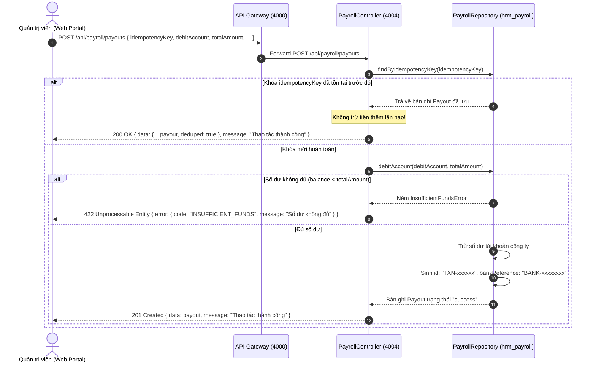

#### Sơ đồ 2: Luồng Lập Phiếu Lương Tự động Gọi Cross-Service (SOA Orchestration)

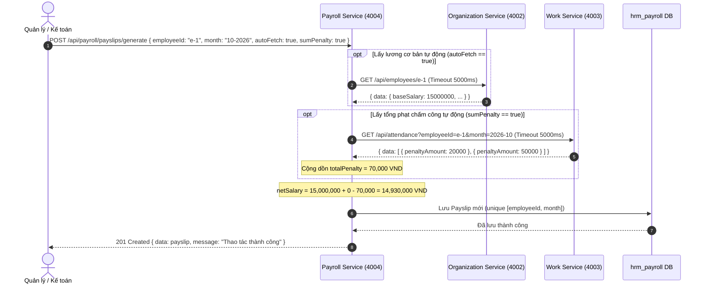

---

### 5.5. Bảng Biến Môi trường Cấu hình (`.env`)

| Biến môi trường | Giá trị mặc định | Bắt buộc | Mô tả chức năng |
|---|---|:---:|---|
| `PORT` | `4004` | Không | Cổng dịch vụ lắng nghe |
| `SERVICE_NAME` | `payroll-service` | Không | Tên dịch vụ hiển thị trong healthcheck và logs |
| `NODE_ENV` | `development` | Không | Môi trường triển khai (`development` / `production`) |
| `DATABASE_URL` | `postgresql://...` | **Có** (cho DB thật) | Chuỗi kết nối tới CSDL `hrm_payroll` trên Supabase |
| `CORS_ORIGIN` | `http://localhost:3000` | Có | Danh sách Origin được phép truy cập |
| `ORGANIZATION_URL` | `http://localhost:4002` | **Có** | Địa chỉ máy chủ Organization Service để gọi lấy lương |
| `WORK_URL` | `http://localhost:4003` | **Có** | Địa chỉ máy chủ Work Service để gọi lấy phạt chấm công |

---

### 5.6. Danh sách Kiểm thử Tự động (Testing Suite)

Dịch vụ đã được cấu hình và chạy kiểm thử tự động với `node:test`:

1. **Kiểm thử Đơn vị (`tests/unit/payroll.test.js`):**
   - Kiểm tra `validatePayout`: Bắt buộc `idempotencyKey`, `debitAccount`, `totalAmount > 0`.
   - Kiểm tra `validateGenerate`: Bắt buộc `employeeId`, `month` chuẩn regex `MM-YYYY`, `baseSalary` (hoặc `autoFetch: true`).
2. **Kiểm thử Tích hợp (`tests/integration/payroll.test.js`):**
   - Quản lý tài khoản ngân hàng: Tạo và lấy danh sách tài khoản doanh nghiệp.
   - Tạo lệnh chi lần 1: Trả về HTTP 201 Created, sinh mã `TXN-*` và `BANK-*`.
   - Gửi lại cùng `idempotencyKey`: Trả về HTTP 200 OK, cờ `deduped: true`, không trừ tiền lần 2.
   - Hết số dư tài khoản: Trả về HTTP 422 với mã `INSUFFICIENT_FUNDS`.
   - Lập phiếu lương: Kiểm tra tính toán `netSalary = baseSalary + bonus - totalPenalty`.
   - Chặn trùng phiếu lương trong cùng 1 tháng: Trả về HTTP 409 `DUPLICATE_RESOURCE`.
   - Điều chỉnh thưởng / phạt: `PUT /api/payroll/payslips/:id` tự động tính lại `netSalary`.
   - Chốt phiếu lương: `PUT /api/payroll/payslips/:id/status` chuyển trạng thái sang `"đã chốt"`.
3. **Kiểm thử Kiểm tra Sức khỏe (`tests/integration/health.test.js`):**
   - `GET /health`: Trả về HTTP 200 với envelope chuẩn `{ status: "ok", service: "payroll-service", time: "..." }`.

---

## 6. DỊCH VỤ 5: WORK SERVICE (`backend/work-service` - Port 4003)

### 6.1. Tổng quan & Vai trò
- **Cổng dịch vụ (Port):** `4003` (`http://localhost:4003`).
- **Thành viên phụ trách:** B (nhánh `feat/work-attendance`).
- **Cơ sở dữ liệu:** `hrm_work` (PostgreSQL độc lập qua Prisma ORM).
- **Nhiệm vụ trọng tâm trong kiến trúc SOA:**
  1. **Quản trị Vận hành Ca kíp (Shift Management):**
     * Thiết lập các khung ca chuẩn (`shift_templates`: Ca sáng, Ca chiều, Ca đêm).
     * Lập lịch ca làm việc chi tiết cho nhân viên (`shifts`) theo ngày (`DD-MM-YYYY`) và chi nhánh (`branchSlug`).
     * Phân công ca trực tiếp (`shift_assignment`: `/api/shifts/:id/assign`).
     * Tiếp nhận nguyện vọng đăng ký ca tự động từ nhân viên trên Mobile App (`schedule_registration`: `/api/shifts/register`), tổng hợp danh sách phục vụ xếp lịch tuần (`RegTimetable`, `WeekWishes`).
  2. **Chấm công Thông minh & Tính Phạt Tự động (Smart Attendance & Penalties):**
     * Điểm danh vào ca (`checkin`) và ra ca (`checkout`) gắn với ca làm việc thực tế.
     * Tự động áp dụng cấu hình phạt chấm công (`attendance_configs`):
       - Miễn phạt trong thời gian ân hạn (`gracePeriodMinutes = 5 phút`).
       - Phạt đi muộn (`latePenaltyAmount = 20,000 VND / lần`).
       - Phạt về sớm (`earlyLeavePenaltyAmount`).
     * Cung cấp API giám sát chấm công toàn bộ nhân sự theo ngày phục vụ màn hình `staff_monitor` của Quản lý chi nhánh (`GET /api/attendance?branchSlug=&date=`).
     * Cung cấp API truy vấn lịch sử chấm công cho `payroll-service` (`GET /api/attendance?employeeId=&month=YYYY-MM`) để trích xuất tổng tiền phạt cộng dồn vào bảng lương tháng.
  3. **Quản lý Tác vụ Ca kíp (Task Management):**
     * Giao việc nội bộ trong ca làm việc cho nhân sự tại từng chi nhánh (`tasks`).
     * Theo dõi chu trình trạng thái công việc: `pending` (chờ làm) -> `in_progress` (đang xử lý) -> `done` (hoàn thành).
  4. **Cơ chế Dual-mode (PostgreSQL + In-memory Fallback):** Sẵn sàng hoạt động ở chế độ in-memory nếu chưa nạp `DATABASE_URL`, đảm bảo mốc kiểm tra sức khỏe `GET /health` luôn thông suốt.

```
                  ┌──────────────────────────────┐
                  │ API Gateway (Port 4000)      │
                  └──────────────┬───────────────┘
                                 │
                   Forward /api/{shifts, shift-templates, attendance, tasks}
                                 │
                                 ▼
         ═════════════════════════════════════════════════
         ║   WORK SERVICE (Port 4003)                    ║
         ║   - Controller: WorkController.js             ║
         ║   - Validator:  workValidator.js              ║
         ║   - Repository: WorkRepository.js             ║
         ║   - Modules:    Shifts, Attendance, Tasks     ║
         ═════════════════════════════════════════════════
                                 │
                   ┌─────────────┴─────────────┐
                   ▼                           ▼
        ┌─────────────────────┐     ┌─────────────────────┐
        │  PostgreSQL DB      │     │ In-Memory Fallback  │
        │  (hrm_work)         │     │ (Local Memory Seed) │
        └─────────────────────┘     └─────────────────────┘
```

### 6.2. Mô hình Dữ liệu & Lược đồ CSDL (`hrm_work`)

#### 1. Bảng Ca làm việc (`shifts` - Prisma Model `Shift`)
```prisma
model Shift {
  id             String   @id @default(cuid())
  employeeId     String
  branchSlug     String?
  date           String   // Định dạng: DD-MM-YYYY
  template       String?  // Tên mẫu ca: Ca sáng, Ca chiều...
  scheduledStart String?  // Giờ bắt đầu: HH:MM (VD: 08:00)
  scheduledEnd   String?  // Giờ kết thúc: HH:MM (VD: 17:00)
  checkIn        String?  // Giờ check-in thực tế: HH:MM
  checkOut       String?  // Giờ check-out thực tế: HH:MM
  status         String   @default("đang làm") // đang làm | hoàn thành | vắng | trễ
  createdAt      DateTime @default(now())
  updatedAt      DateTime @updatedAt

  @@map("shifts")
}
```

#### 2. Bảng Chấm công (`attendances` - Prisma Model `Attendance`)
```prisma
model Attendance {
  id            String   @id @default(cuid())
  employeeId    String
  shiftId       String?
  date          String   // Định dạng: DD-MM-YYYY
  checkIn       String?  // Giờ vào: HH:MM
  checkOut      String?  // Giờ ra: HH:MM
  penaltyAmount Float    @default(0) // Số tiền phạt (VND)
  penaltyNote   String?  // Lý do phạt: "Đi trễ", "Về sớm"
  status        String   @default("present") // present | absent | late | early_leave
  createdAt     DateTime @default(now())

  @@map("attendances")
}
```

#### 3. Bảng Cấu hình Chấm công & Phạt (`attendance_configs` - Prisma Model `AttendanceConfig`)
```prisma
model AttendanceConfig {
  id                      String  @id @default("default")
  latePenaltyAmount       Int     @default(20000) // Tiền phạt đi muộn (20,000 VND)
  earlyLeavePenaltyAmount Int     @default(0)     // Tiền phạt về sớm
  gracePeriodMinutes      Int     @default(5)     // Thời gian ân hạn miễn phạt (5 phút)
  autoCloseShift          Boolean @default(false)
  shiftSwapMode           String  @default("manual")
  latePenaltyPct          Int     @default(10)
  earlyLeavePenaltyPct    Int     @default(10)
  earlyCheckinMinutes     Int     @default(15)
  maxPenaltiesPerMonth    Int     @default(10)
  deductOnCheckout        Boolean @default(true)
  allowDoubleCheckin      Boolean @default(true)
  maxCheckinsPerDay       Int     @default(3)
  maxSwapsPerMonth        Int     @default(3)
  requireReasonSwap       Boolean @default(true)

  @@map("attendance_configs")
}
```

#### 4. Bảng Mẫu ca làm việc (`shift_templates` - Prisma Model `ShiftTemplate`)
```prisma
model ShiftTemplate {
  id        String   @id @default(cuid())
  name      String   // VD: "Ca Sáng (08:00 - 12:00)"
  startTime String   // "08:00"
  endTime   String   // "12:00"
  createdAt DateTime @default(now())
  updatedAt DateTime @updatedAt

  @@map("shift_templates")
}
```

#### 5. Bảng Đăng ký Ca làm việc (`shift_registrations` - Prisma Model `ShiftRegistration`)
```prisma
model ShiftRegistration {
  id         String   @id @default(cuid())
  employeeId String
  branchSlug String?
  week       String?  // Tuần làm việc, VD: "W42-2026"
  shiftId    String?
  wish       String?  // Nguyện vọng ca làm việc
  createdAt  DateTime @default(now())

  @@map("shift_registrations")
}
```

#### 6. Bảng Tác vụ Ca kíp (`tasks` - Prisma Model `Task`)
```prisma
model Task {
  id          String   @id @default(cuid())
  title       String
  description String?
  assignedTo  String?  // Mã nhân viên phụ trách (employeeId)
  branchSlug  String?
  dueDate     String?
  status      String   @default("pending") // pending | in_progress | done
  createdAt   DateTime @default(now())
  updatedAt   DateTime @updatedAt

  @@map("tasks")
}
```

---

### 6.3. Đặc tả Chi tiết các Chức năng Nghiệp vụ & API Endpoints

#### 1. Quản lý Ca làm việc (Shifts API)
| Method | Đường dẫn | Chức năng nghiệp vụ & Quy tắc kiểm tra | Mã phản hồi |
|---|---|---|:---:|
| `GET` | `/api/shifts` | Danh sách ca làm việc với bộ lọc:<br/>- `?branchSlug=`: Lọc theo chi nhánh.<br/>- `?date=`: Lọc theo ngày (định dạng `DD-MM-YYYY`).<br/>- `?employeeId=`: Lọc ca cá nhân của nhân viên. | `200` |
| `GET` | `/api/shifts/:id` | Lấy chi tiết 1 ca làm việc theo ID. | `200` / `404` |
| `POST` | `/api/shifts` | Tạo ca làm việc mới.<br/>- Bắt buộc: `date` (`DD-MM-YYYY`), cùng ít nhất `employeeId` hoặc `branchSlug`. | `201` / `400` |
| `PUT` | `/api/shifts/:id` | Cập nhật ca làm việc (giờ bắt đầu, giờ kết thúc, trạng thái). | `200` / `404` |
| `DELETE` | `/api/shifts/:id` | Xóa bỏ ca làm việc. | `200` / `404` |
| `POST` | `/api/shifts/:id/assign` | Phân công ca làm việc cho nhân viên (`shift_assignment`).<br/>- Bắt buộc: `employeeId`. | `200` / `400` / `404` |
| `POST` | `/api/shifts/register` | Nhân viên tự gửi nguyện vọng đăng ký ca (`schedule_registration`).<br/>- Bắt buộc: `employeeId`. | `201` / `400` |
| `GET` | `/api/shifts/registrations` | Danh sách nguyện vọng đăng ký ca của nhân viên (phục vụ bảng phân lịch trên Web: `RegTimetable`, `WeekWishes`). | `200` |

#### 2. Quản lý Mẫu ca Chuẩn (Shift Templates API)
| Method | Đường dẫn | Chức năng nghiệp vụ & Quy tắc kiểm tra | Mã phản hồi |
|---|---|---|:---:|
| `GET` | `/api/shift-templates` (hoặc `/api/shifts/templates`) | Lấy danh sách toàn bộ các khung ca làm việc mẫu. | `200` |
| `POST` | `/api/shift-templates` (hoặc `/api/shifts/templates`) | Tạo mới khung ca mẫu.<br/>- Bắt buộc: `name`, `startTime`, `endTime`. | `201` / `400` |
| `PUT` | `/api/shift-templates/:id` | Cập nhật tên hoặc thời gian khung ca mẫu. | `200` / `404` |
| `DELETE` | `/api/shift-templates/:id` | Xóa bỏ khung ca mẫu. | `200` / `404` |

#### 3. Chấm công & Tính Phạt Vi phạm (Attendance API)
| Method | Đường dẫn | Chức năng nghiệp vụ & Quy tắc kiểm tra | Mã phản hồi |
|---|---|---|:---:|
| `GET` | `/api/attendance/config` | Lấy bảng cấu hình chấm công và mức phạt hiện tại. | `200` |
| `PUT` | `/api/attendance/config` | Cập nhật cấu hình phạt chấm công (Admin điều chỉnh tiền phạt, phút ân hạn). | `200` |
| `POST` | `/api/attendance/checkin` | Ghi nhận chấm công vào ca (`checkIn`).<br/>- Bắt buộc: `employeeId`.<br/>- Ghi nhận trạng thái `present` và lưu giờ check-in thực tế. | `201` / `400` |
| `POST` | `/api/attendance/checkout` | Ghi nhận chấm công ra ca (`checkOut`) & **Tính phạt tự động**:<br/>- Tự động tìm kiếm bản ghi check-in trong ngày chưa check-out.<br/>- Nếu về sớm trước giờ quy định: Tự động ghi nhận `status = "early_leave"` và gán `penaltyAmount = earlyLeavePenaltyAmount`. | `200` / `400` |
| `GET` | `/api/attendance` | Tra cứu lịch sử chấm công với các bộ lọc linh hoạt:<br/>- `?employeeId=` & `?month=YYYY-MM`: Dùng cho `payroll-service` lấy toàn bộ tiền phạt trong tháng để trừ lương.<br/>- `?branchSlug=` & `?date=DD-MM-YYYY`: Dùng cho màn hình giám sát nhân sự chi nhánh trong ngày (`staff_monitor`). | `200` |

#### 4. Quản lý Tác vụ Ca kíp (Tasks API)
| Method | Đường dẫn | Chức năng nghiệp vụ & Quy tắc kiểm tra | Mã phản hồi |
|---|---|---|:---:|
| `GET` | `/api/tasks` | Lấy danh sách tác vụ (hỗ trợ lọc theo `branchSlug`, `assignedTo`, `status`). | `200` |
| `GET` | `/api/tasks/:id` | Lấy thông tin chi tiết một tác vụ. | `200` / `404` |
| `POST` | `/api/tasks` | Giao tác vụ mới trong ca.<br/>- Bắt buộc: `title`.<br/>- Khởi tạo mặc định: `status: "pending"`. | `201` / `400` |
| `PUT` | `/api/tasks/:id` | Cập nhật tiến độ / trạng thái tác vụ (`pending` / `in_progress` / `done`). | `200` / `400` / `404` |
| `DELETE` | `/api/tasks/:id` | Xóa tác vụ. | `200` / `404` |

#### 5. Kiểm tra Sức khỏe (Healthcheck)
- `GET /health`: Trả về HTTP 200 `{ "status": "ok", "service": "work-service", "time": "..." }`.

---

### 6.4. Sơ đồ Luồng Nghiệp vụ & Tích hợp Microservices

#### Sơ đồ 1: Luồng Chấm công Vào/Ra và Tính Phạt Tự động trên Mobile

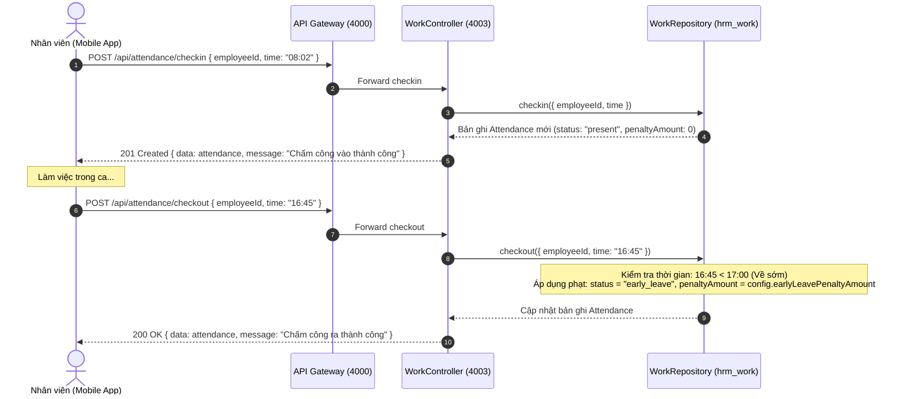

#### Sơ đồ 2: Luồng Payroll Service Tra cứu Phạt Chấm công Hàng tháng

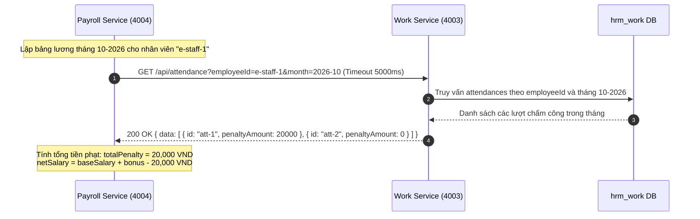

---

### 6.5. Bảng Biến Môi trường Cấu hình (`.env`)

| Biến môi trường | Giá trị mặc định | Bắt buộc | Mô tả chức năng |
|---|---|:---:|---|
| `PORT` | `4003` | Không | Cổng dịch vụ lắng nghe |
| `SERVICE_NAME` | `work-service` | Không | Tên dịch vụ hiển thị trong healthcheck và logs |
| `NODE_ENV` | `development` | Không | Môi trường triển khai (`development` / `production`) |
| `DATABASE_URL` | `postgresql://...` | **Có** (cho DB thật) | Chuỗi kết nối tới CSDL `hrm_work` trên Supabase |
| `CORS_ORIGIN` | `http://localhost:3000` | Có | Danh sách Origin được phép truy cập |

---

### 6.6. Danh sách Kiểm thử Tự động (Testing Suite)

Dịch vụ đã được cấu hình và chạy kiểm thử tự động với `node:test`:

1. **Kiểm thử Đơn vị (`tests/unit/work.test.js`):**
   - Kiểm tra `validateShift`: Bắt buộc phải có `date` và (`employeeId` hoặc `branchSlug`).
   - Kiểm tra `validateTask`: Bắt buộc phải có `title`.
2. **Kiểm thử Tích hợp (`tests/integration/work.test.js`):**
   - Đọc cấu hình phạt mặc định: `latePenaltyAmount = 20000`, `gracePeriodMinutes = 5`.
   - Tạo ca làm việc mới: Trả về HTTP 201 Created; thiếu ngày trả về HTTP 400.
   - Chu trình chấm công: Check-in tạo bản ghi mới (201), Check-out tự động tính phạt (200), tra cứu lịch sử chấm công theo `employeeId`.
   - Chu trình tác vụ (Tasks): Tạo tác vụ mới (201), lọc theo chi nhánh và trạng thái (200), cập nhật trạng thái `done` (200).
3. **Kiểm thử Kiểm tra Sức khỏe (`tests/integration/health.test.js`):**
   - `GET /health`: Trả về HTTP 200 với envelope chuẩn `{ status: "ok", service: "work-service", time: "..." }`.

---

## 7. DỊCH VỤ 6: INTEGRATION SERVICE (`backend/integration-service` - Port 4005)

### 7.1. Tổng quan & Vai trò
- **Cổng dịch vụ (Port):** `4005` (`http://localhost:4005`).
- **Database:** Sở hữu cơ sở dữ liệu `hrm_integration` (PostgreSQL qua Prisma ORM).
- **Nhiệm vụ trọng tâm:**
  1. **Cổng Tích hợp Ngân hàng SOAP (SOAP Core Banking Gateway):** Cung cấp endpoint SOAP XML 1.1/1.2 (`/soap/payroll`) cho hệ thống Core Banking của các ngân hàng đối tác gửi lệnh chi lương tự động, chuyển đổi XML sang lệnh chi nội bộ sang `payroll-service` và trả XML `PayoutResponse` hoặc `soap:Fault`.
  2. **Vòng đời Đơn từ & Tự động Phê duyệt (Request Lifecycle Engine):** Quản lý toàn bộ đơn từ hành chính của nhân viên (xin nghỉ phép, tăng ca, tạm ứng lương, đổi ca trực, giải trình chấm công). Khi duyệt đơn đổi ca (`shift_swap`), tự động đồng bộ hóa cập nhật phân ca sang `work-service` và tự động bắn thông báo cho nhân viên.
  3. **Hệ thống Thông báo Đa kênh (Notification Hub):** Quản lý thông báo broadcast toàn công ty hoặc gửi đích danh từng nhân viên (`targetEmployeeId`), theo dõi trạng thái đã đọc (`isRead`).
  4. **Cấu hình Wi-Fi Chống Gian lận (Wi-Fi Geofencing Registry):** Quản lý danh sách Wi-Fi hợp lệ của từng chi nhánh (so khớp địa chỉ phần cứng `BSSID`, `SSID`, mã chi nhánh `branch`) làm căn cứ cho `work-service` xác thực chấm công.
  5. **Truyền thông Nội bộ & Quy chế (News & Regulations):** Quản lý bảng tin thông báo, văn bản chính sách, điều lệ công ty có phân loại tone màu, ghim ưu tiên và phiên bản văn bản.
  6. **Cấu hình Kết nối Cổng SOAP (`soap-config`):** Quản lý địa chỉ WSDL, endpoint, chế độ bảo mật và danh sách IP ngân hàng được phép truy cập (`allowedIPs`).
  7. **Dịch vụ Tải ảnh Đa phương tiện (`/api/upload`):** Tích hợp Cloudinary SDK tiếp nhận ảnh Base64 / Data URL (ảnh minh chứng giải trình, chứng từ y tế, avatar) và lưu trữ bảo mật trên đám mây.

```
                      ┌──────────────────────────────────────────────┐
                      │            API GATEWAY (Port 4000)           │
                      └──────────────────────┬───────────────────────┘
                                             │
                       Proxy HTTP / REST     │    SOAP XML Passthrough
                       (Header: x-user-*)    │    (text/xml)
                                             ▼
       ═══════════════════════════════════════════════════════════════════════════
       ║             INTEGRATION SERVICE (Port 4005 - hrm_integration)           ║
       ║  ┌──────────────┐  ┌──────────────┐  ┌──────────────┐  ┌──────────────┐  ║
       ║  │ Requests     │  │ Notifications│  │ Wifi Configs │  │ News & Regs  │  ║
       ║  └──────┬───────┘  └──────────────┘  └──────────────┘  └──────────────┘  ║
       ║         │ (Duyệt đổi ca)                                                 ║
       ║         │                                     SOAP / XML Dispatch        ║
       ║         │                                              │                 ║
       ║  ┌──────▼────────┐                            ┌────────▼────────┐        ║
       ║  │  WorkClient   │                            │  PayrollClient  │        ║
       ║  │ (HTTP 5000ms) │                            │ (HTTP 5000ms)   │        ║
       ══════════╪══════════════════════════════════════════════╪═════════════════
                 │                                              │
                 ▼                                              ▼
       ┌──────────────────┐                           ┌──────────────────┐
       │   work-service   │                           │ payroll-service  │
       │   (Port 4003)    │                           │   (Port 4004)    │
       │  Cập nhật Ca kíp │                           │  Tạo Payout REST │
       └──────────────────┘                           └──────────────────┘
```

---

### 7.2. Chi tiết Nghiệp vụ & Cơ chế Kỹ thuật

#### 1. Cổng Tích hợp SOAP Chi lương Ngân hàng (`/soap/payroll`)
- **Tải tài liệu WSDL:** Ngân hàng gửi `GET /soap/payroll?wsdl` -> Service phản hồi file WSDL chuẩn XML (`text/xml; charset=utf-8`) định nghĩa cấu trúc `PayoutRequest` và `PayoutResponse`.
- **Tiếp nhận Lệnh chi XML (`POST /soap/payroll`):**
  - Nhận nội dung XML nguyên vẹn, bóc tách các trường: `referenceId`, `amount`, `bankAccountId`, `idempotencyKey`.
  - Nếu thiếu trường bắt buộc hoặc XML không đúng cấu trúc: Trả về HTTP 400 kèm `soap:Fault` với `<faultcode>soap:Client</faultcode>`.
  - Chuyển tiếp lệnh sang `payroll-service` bằng lời gọi HTTP nội bộ `PayrollClient.createPayout({ bankAccountId, amount, idempotencyKey, note })`.
- **Chuyển đổi Lỗi Nghiệp vụ Ngân hàng:**
  - Nếu `payroll-service` trả về HTTP 422 hoặc mã `INSUFFICIENT_FUNDS`: Service sinh `soap:Fault` với nội dung `"Số dư không đủ"` gửi về Core Banking.
  - Nếu `payroll-service` timeout (> 5000ms): Trả về `soap:Fault` HTTP 502 `"Không kết nối được dịch vụ chi lương"`.
- **Phản hồi Thành công:** Trả về XML `PayoutResponse` nguyên vẹn mang `TransactionId`, `BankReference`, và `Status: "success"`.

#### 2. Vòng đời Quản lý Đơn từ (Request Management & Shift Swap Automation)
- **Các loại đơn hỗ trợ (`type`):**
  - `leave`: Đơn xin nghỉ phép (nghỉ ốm, việc riêng, nghỉ phép năm).
  - `overtime`: Đơn đăng ký làm thêm giờ.
  - `advance`: Đơn xin tạm ứng lương giữa tháng.
  - `shift_swap`: Đơn xin đổi ca làm việc giữa các nhân viên.
  - `work_supplement`: Đơn giải trình bổ sung công (quên check-in/out, sự cố thiết bị).
  - `other`: Các kiến nghị và yêu cầu hành chính khác.
- **Trạng thái đơn (`status`):** `pending` (chờ duyệt) $\rightarrow$ `approved` (đã duyệt) HOẶC `rejected` (bị từ chối). Chỉ có đơn ở trạng thái `pending` mới được phép xóa hoặc phê duyệt.
- **Tự động hóa khi Duyệt Đơn (Post-approval Automation):**
  1. **Sinh Thông báo Tức thì:** Hệ thống tự động tạo bản ghi `Notification` gửi tới đúng nhân viên làm đơn (`targetEmployeeId = row.employeeId`) thông báo kết quả phê duyệt kèm lời nhắn phản hồi của quản lý (`reviewNote`).
  2. **Tự động Hoán đổi Ca làm việc:** Nếu đơn là `shift_swap` và có `sourceShiftId`: Service tự động gọi sang `work-service` (`WorkClient.updateShift(sourceShiftId, { employeeId: row.employeeId })`) để gán lại nhân sự cho ca trực. Lời gọi này thực hiện theo cơ chế *best-effort* (không làm đứt gãy luồng duyệt đơn nếu `work-service` phản hồi chậm).

#### 3. Quản lý Thông báo Người dùng (Notification System)
- **2 Chế độ gửi:**
  - *Broadcast Toàn Hệ Thống:* `targetEmployeeId = null` (mọi nhân viên đều nhìn thấy thông báo này).
  - *Gửi Đích Danh:* `targetEmployeeId = "e-xxx"` (chỉ nhân viên cụ thể mới thấy).
- **Hỗ trợ Dữ liệu Metadata giàu:** Lưu trữ thông tin ca kíp liên quan (`shiftName`, `shiftDate`, `shiftTime`, `shiftHours`) và thông tin người gửi (`senderName`, `senderRole`, `senderPhone`).
- **Thao tác Đọc:** Hỗ trợ đọc từng thông báo (`PUT /api/notifications/:id/read`) hoặc đọc tất cả (`PUT /api/notifications/read-all`).

#### 4. Cấu hình Wi-Fi Chống Gian lận Chấm công (`/api/wifi-configs`)
- Mỗi bản ghi lưu trữ: `ssid` (Tên mạng), `bssid` (Địa chỉ MAC phần cứng của Router/Access Point tại cửa hàng), mã `branch` (ví dụ: `hn-1`, `hn-2`), trạng thái `status` (`"hoạt động"` / `"vô hiệu hóa"`).
- Khi nhân viên bấm chấm công trên Mobile App, App sẽ đọc `BSSID` của mạng Wi-Fi điện thoại đang kết nối và gửi kèm yêu cầu. Hệ thống đối soát trực tiếp với danh sách cấu hình này để ngăn chặn 100% việc chấm công giả mạo.

#### 5. Bảng tin Nội bộ (`/api/news`) & Quy chế Chính sách (`/api/regulations`)
- **Bảng tin (`news`):** Lưu trữ tin tức truyền thông nội bộ, bài viết tuyển dụng, chúc mừng sinh nhật, vinh danh nhân viên xuất sắc. Hỗ trợ gắn thẻ `tag`, phân loại tone màu giao diện `tagTone` (`danger`, `warning`, `success`, `primary`, `gray`), và cờ ưu tiên ghim đầu trang `pinned`.
- **Quy chế (`regulations`):** Lưu trữ văn bản quy định, chính sách thưởng phạt, nội quy lao động, quy trình an toàn. Có mã văn bản `code`, số phiên bản `version` (mặc định `"1.0"`), phạm vi áp dụng `scope`, ngày hiệu lực `effectiveDate`, ngày hết hạn `expiryDate`, và số lượng tệp đính kèm `attachments`.

#### 6. Dịch vụ Tải ảnh Đa phương tiện Cloudinary (`/api/upload`)
- Nhận dữ liệu ảnh dưới dạng chuỗi `base64`, `dataUrl`, hoặc `image`.
- Tự động tải lên dịch vụ đám mây Cloudinary vào thư mục `folder: "hrm"`.
- Trả về đường dẫn CDN an toàn (`secure_url`), định dạng, kích thước và định danh `public_id`. Dùng để lưu trữ ảnh đại diện, ảnh chụp giấy khám sức khỏe (đơn nghỉ ốm), hoặc hóa đơn chứng từ tạm ứng.

---

### 7.3. Cấu trúc Mô hình Dữ liệu Prisma (`hrm_integration`)

```prisma
// CSDL hrm_integration trên PostgreSQL (Database-per-service)

model Request {
  id            String   @id @default(cuid())
  type          String   // leave | overtime | advance | shift_swap | work_supplement | other
  employeeId    String
  branchSlug    String?
  title         String
  content       String
  attachmentUrl String?
  status        String   @default("pending") // pending | approved | rejected
  reviewedBy    String?
  reviewNote    String?
  sourceShiftId String?
  targetShiftId String?
  createdAt     DateTime @default(now())
  updatedAt     DateTime @updatedAt

  @@map("requests")
}

model Notification {
  id               String   @id @default(cuid())
  targetEmployeeId String?  // null = broadcast toàn hệ thống
  branchSlug       String?
  title            String
  body             String
  isRead           Boolean  @default(false)
  metadata         Json?
  requestType      String?
  shiftName        String?
  shiftDate        String?
  shiftTime        String?
  shiftHours       String?
  senderName       String?
  senderRole       String?
  senderPhone      String?
  createdAt        DateTime @default(now())

  @@map("notifications")
}

model SoapGatewayConfig {
  id              String   @id @default("default")
  endpointUrl     String
  wsdlUrl         String
  serviceName     String
  port            Int      @default(8443)
  securityMode    String
  allowedIPs      String[]
  status          String   @default("unknown")
  lastPingTime    String?
  avgResponseTime String?

  @@map("soap_gateway_configs")
}

model News {
  id        String   @id @default(cuid())
  title     String
  summary   String
  content   String
  author    String
  date      String   // DD-MM-YYYY
  tag       String
  tagTone   String   @default("primary") // danger | warning | success | primary | gray
  pinned    Boolean  @default(false)
  createdAt DateTime @default(now())
  updatedAt DateTime @updatedAt

  @@map("news")
}

model Regulation {
  id            String   @id @default(cuid())
  code          String
  title         String
  category      String
  summary       String
  content       String
  status        String   @default("hiệu lực") // hiệu lực | dự thảo | hết hiệu lực
  scope         String   @default("Toàn công ty")
  effectiveDate String   // DD-MM-YYYY
  expiryDate    String?
  author        String
  version       String   @default("1.0")
  pinned        Boolean  @default(false)
  attachments   Int      @default(0)
  createdAt     DateTime @default(now())
  updatedAt     DateTime @updatedAt

  @@map("regulations")
}

model WifiConfig {
  id        String   @id @default(cuid())
  ssid      String
  bssid     String
  branch    String   // slug chi nhánh: HN-1, HN-2, DN-1...
  status    String   @default("hoạt động") // hoạt động | vô hiệu hóa
  createdAt DateTime @default(now())
  updatedAt DateTime @updatedAt

  @@map("wifi_configs")
}
```

---

### 7.4. Sơ đồ Luồng Nghiệp vụ (Workflows & Sequence Diagrams)

#### Sơ đồ 1: Luồng Xử lý Đơn Đổi ca Khép kín (`shift_swap`)
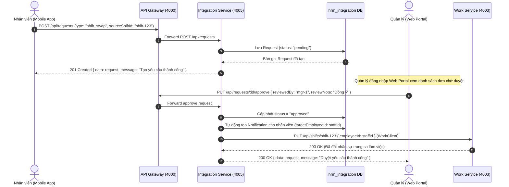

#### Sơ đồ 2: Core Banking Thực hiện Lệnh Chi lương qua Cổng SOAP XML
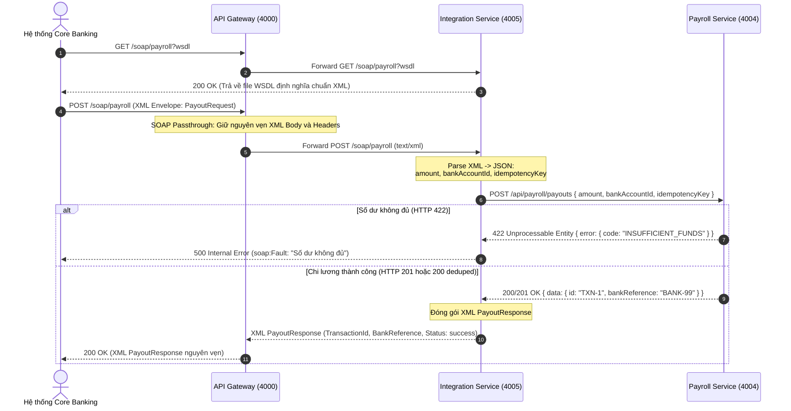

---

### 7.5. Danh mục REST & SOAP API của Integration Service

#### 1. Cổng SOAP Ngân hàng (`/soap/payroll`)
| Method | Đường dẫn | Chức năng nghiệp vụ & Quy tắc dữ liệu | Định dạng trả về |
|---|---|---|:---:|
| `GET` | `/soap/payroll?wsdl` | Trả file XML WSDL mô tả dịch vụ chi lương tự động. | `text/xml` (200) |
| `POST` | `/soap/payroll` | Nhận `PayoutRequest` XML, bóc tách dữ liệu và gọi `payroll-service`. Trả về `PayoutResponse` XML hoặc `soap:Fault`. | `text/xml` (200 / 400 / 500 / 502) |

#### 2. Quản lý Đơn từ (`/api/requests`)
| Method | Đường dẫn | Chức năng nghiệp vụ & Quy tắc kiểm tra | Mã phản hồi |
|---|---|---|:---:|
| `GET` | `/api/requests` | Danh sách đơn từ (lọc theo `type`, `employeeId`, `status`, `branchSlug`). | `200` |
| `GET` | `/api/requests/:id` | Xem chi tiết một đơn từ. | `200` / `404` |
| `POST` | `/api/requests` | Tạo mới đơn từ (`leave`, `overtime`, `advance`, `shift_swap`,...). Bắt buộc: `type`, `title`, `content`. | `201` / `400` |
| `PUT` | `/api/requests/:id/approve` | Duyệt đơn: Tự động sinh `Notification` và đổi ca nếu là `shift_swap`. | `200` / `400` / `404` |
| `PUT` | `/api/requests/:id/reject` | Từ chối đơn: Tự động sinh `Notification` báo lý do từ chối. | `200` / `400` / `404` |
| `DELETE` | `/api/requests/:id` | Xóa đơn từ (Chỉ cho phép xóa khi đơn đang ở trạng thái `pending`). | `200` / `400` / `404` |

#### 3. Quản lý Thông báo (`/api/notifications`)
| Method | Đường dẫn | Chức năng nghiệp vụ & Quy tắc kiểm tra | Mã phản hồi |
|---|---|---|:---:|
| `GET` | `/api/notifications` | Lấy danh sách thông báo (tự động gồm broadcast và thông báo riêng của `employeeId`). | `200` |
| `POST` | `/api/notifications` | Tạo thông báo mới (Admin / Quản lý phát thông báo). Bắt buộc: `title`, `body`. | `201` / `400` |
| `PUT` | `/api/notifications/:id/read` | Đánh dấu 1 thông báo đã đọc (`isRead = true`). | `200` / `404` |
| `PUT` | `/api/notifications/read-all` | Đánh dấu tất cả thông báo của nhân viên đã đọc. | `200` |
| `DELETE` | `/api/notifications/:id` | Xóa thông báo. | `200` / `404` |

#### 4. Cấu hình Wi-Fi Chấm công (`/api/wifi-configs`)
| Method | Đường dẫn | Chức năng nghiệp vụ & Quy tắc kiểm tra | Mã phản hồi |
|---|---|---|:---:|
| `GET` | `/api/wifi-configs` | Lấy danh sách Wi-Fi hợp lệ theo chi nhánh (lọc `?branch=hn-1`). | `200` |
| `POST` | `/api/wifi-configs` | Đăng ký mạng Wi-Fi chấm công mới (`ssid`, `bssid`, `branch`). | `201` / `400` |
| `PUT` | `/api/wifi-configs/:id` | Cập nhật thông tin router Wi-Fi hoặc vô hiệu hóa. | `200` / `404` |
| `DELETE` | `/api/wifi-configs/:id` | Xóa cấu hình Wi-Fi. | `200` / `404` |

#### 5. Bảng tin (`/api/news`) & Quy chế (`/api/regulations`)
| Method | Đường dẫn | Chức năng nghiệp vụ | Mã phản hồi |
|---|---|---|:---:|
| `GET` / `POST` | `/api/news` | Danh sách bảng tin truyền thông / Tạo bài viết mới. | `200` / `201` |
| `PUT` / `DELETE` | `/api/news/:id` | Sửa nội dung bảng tin / Xóa bài viết. | `200` / `404` |
| `GET` / `POST` | `/api/regulations` | Danh sách văn bản quy chế / Ban hành quy chế mới. | `200` / `201` |
| `PUT` / `DELETE` | `/api/regulations/:id` | Cập nhật quy chế / Hủy hiệu lực quy chế. | `200` / `404` |

#### 6. Tải ảnh Lên Đám mây (`/api/upload`)
| Method | Đường dẫn | Chức năng nghiệp vụ & Định dạng Payload | Mã phản hồi |
|---|---|---|:---:|
| `POST` | `/api/upload` | Tải ảnh Base64 / Data URL lên Cloudinary thư mục `hrm`. Nhận `{ file: "data:image/png;base64,..." }`. Trả về `{ data: { secure_url, public_id } }`. | `200` / `400` |

---

### 7.6. Bảng Biến Môi trường Cấu hình (`.env`)

| Tên biến | Giá trị mẫu | Bắt buộc | Mô tả chức năng |
|---|---|:---:|---|
| `PORT` | `4005` | Không | Cổng dịch vụ lắng nghe |
| `SERVICE_NAME` | `integration-service` | Không | Tên định danh service |
| `DATABASE_URL` | `postgresql://...` | **Có** (khi chạy DB) | Chuỗi kết nối tới CSDL `hrm_integration` |
| `PAYROLL_SERVICE_URL` | `http://localhost:4004` | **Có** | Địa chỉ gọi nội bộ sang `payroll-service` |
| `WORK_SERVICE_URL` | `http://localhost:4003` | **Có** | Địa chỉ gọi nội bộ sang `work-service` để cập nhật ca kíp |
| `CLOUDINARY_CLOUD_NAME` | `...` | Tùy chọn | Tên tài khoản lưu trữ Cloudinary |
| `CLOUDINARY_API_KEY` | `...` | Tùy chọn | API Key xác thực Cloudinary |
| `CLOUDINARY_API_SECRET` | `...` | Tùy chọn | Secret key bảo mật Cloudinary |

---

### 7.7. Danh sách Kiểm thử Tự động (Testing Suite)

Dịch vụ đã được cấu hình bộ kiểm thử tự động với `node:test` bao gồm:
1. **Kiểm thử Quản lý Đơn từ & Thông báo (`requests-notifications-soap.test.js`):**
   - Đọc danh sách thông báo: Đảm bảo thông báo broadcast (`targetEmployeeId = null`) luôn trả về cho mọi nhân viên.
   - Tạo thông báo mới: Trả về HTTP 201; thiếu trường bắt buộc trả về HTTP 400.
   - Thao tác đọc thông báo: Đánh dấu `isRead = true` thành công.
2. **Kiểm thử Tích hợp SOAP (`requests-notifications-soap.test.js`):**
   - `GET /soap/payroll?wsdl`: Trả về HTTP 200 kèm `Content-Type: text/xml` và nội dung chứa định nghĩa `PayoutRequest`.
   - `POST /soap/payroll` gửi XML thiếu trường: Phản hồi HTTP 400 mang cấu trúc `<faultcode>soap:Client</faultcode>`.
   - Gửi XML sai cú pháp: Hệ thống bắt lỗi an toàn và trả về `soap:Fault`.
3. **Kiểm thử Quản lý Bảng tin, Quy chế, Wi-Fi (`management.test.js`):**
   - CRUD Bảng tin (`/api/news`): Tạo mới có gắn cờ `pinned`, lọc danh sách, sửa bài viết, xóa bài viết.
   - CRUD Quy chế (`/api/regulations`): Ban hành quy chế mới, kiểm tra trạng thái `"hiệu lực"`, phân loại danh mục.
   - CRUD Wi-Fi Chấm công (`/api/wifi-configs`): Tạo mới cấu hình theo mã chi nhánh, lấy danh sách theo bộ lọc chi nhánh.
4. **Kiểm thử Kiểm tra Sức khỏe (`health.test.js`):**
   - `GET /health`: Trả về HTTP 200 `{ "status": "ok", "service": "integration-service", "time": "..." }`.

---

## 8. MA TRẬN TRA CỨU NHANH CHO AI CHATBOT (AI QUICK REFERENCE MATRIX)

> **MỤC ĐÍCH PHẦN NÀY:** Cung cấp bảng tra cứu thần tốc (Cheat Sheet / Semantic Mapping) để AI Chatbot có thể tra cứu và trả lời câu hỏi của người dùng ngay lập tức mà không cần suy luận phức tạp.

### 8.1. Bảng Tra cứu Tính năng & Điều hướng Dịch vụ (Feature-to-Service Lookup)

| Khi Người Dùng Hỏi Về... | Dịch Vụ Phụ Trách | Port | API Endpoint Chính | Cơ Sở Dữ Liệu Sở Hữu |
|---|---|:---:|---|---|
| Đăng nhập, cấp lại mật khẩu, làm mới token, theo dõi thiết bị | `identity-service` | `4001` | `POST /api/auth/login`<br/>`POST /api/auth/refresh`<br/>`POST /api/auth/forgot-password` | `hrm_identity` (Bảng `users`) |
| Quản lý Chi nhánh, Phòng ban, Hồ sơ Nhân viên, Lương cơ bản | `organization-service` | `4002` | `GET/POST /api/branches`<br/>`GET/POST /api/departments`<br/>`GET/POST /api/employees` | `hrm_organization` (`branches`, `departments`, `employees`) |
| Phân chia ca kíp, Mẫu ca làm việc, Đăng ký ca | `work-service` | `4003` | `GET/POST /api/shifts`<br/>`GET/POST /api/shift-templates` | `hrm_work` (`shifts`, `shift_templates`) |
| Chấm công Wi-Fi (Check-in/out), Phạt đi muộn, Phạt về sớm, Màn hình giám sát quân số | `work-service` | `4003` | `POST /api/attendance/checkin`<br/>`POST /api/attendance/checkout`<br/>`GET /api/attendance?branchSlug=...` | `hrm_work` (`attendances`, `attendance_configs`) |
| Giao việc trong ca, tiến độ nhiệm vụ | `work-service` | `4003` | `GET/POST /api/tasks` | `hrm_work` (`tasks`) |
| Tính toán bảng lương tháng, Tự động gom phạt chấm công, Lương thực lĩnh | `payroll-service` | `4004` | `POST /api/payroll/calculate`<br/>`GET /api/payroll/payslips` | `hrm_payroll` (`payslips`) |
| Lệnh chuyển khoản lương REST, Chống chi trùng lặp (`idempotencyKey`), Tài khoản công ty | `payroll-service` | `4004` | `POST /api/payroll/payouts`<br/>`GET /api/payroll/company-accounts` | `hrm_payroll` (`payout_transactions`, `company_bank_accounts`) |
| Cổng ngân hàng SOAP XML (WSDL, PayoutRequest, soap:Fault) | `integration-service` | `4005` | `GET /soap/payroll?wsdl`<br/>`POST /soap/payroll` | Không lưu bảng (gọi sang `payroll-service`) |
| Đơn từ (Nghỉ phép, Ứng lương, Đổi ca), Tự động đồng bộ ca sang work-service | `integration-service` | `4005` | `GET/POST /api/requests`<br/>`PUT /api/requests/:id/approve` | `hrm_integration` (`requests`) |
| Thông báo người dùng (Broadcast hoặc đích danh), Đánh dấu đã đọc | `integration-service` | `4005` | `GET/POST /api/notifications`<br/>`PUT /api/notifications/:id/read` | `hrm_integration` (`notifications`) |
| Đăng ký Router Wi-Fi chi nhánh (SSID, BSSID MAC) chống gian lận | `integration-service` | `4005` | `GET/POST /api/wifi-configs` | `hrm_integration` (`wifi_configs`) |
| Bảng tin truyền thông nội bộ, Văn bản chính sách quy chế | `integration-service` | `4005` | `GET/POST /api/news`<br/>`GET/POST /api/regulations` | `hrm_integration` (`news`, `regulations`) |
| Tải ảnh avatar, chứng từ y tế lên Cloudinary | `integration-service` | `4005` | `POST /api/upload` | Đám mây Cloudinary |
| Xác thực JWT, Giới hạn tần suất 300 req/min, Chuyển tiếp request, Reverse Proxy | `api-gateway` | `4000` | Mọi request từ Web (3000) và Mobile | **Không có DB** (Stateless) |

---

### 8.2. Danh mục Xử lý Tình huống Lỗi Thường Gặp (Failure Modes & System Behavior)

| Tình Huống Sự Cố | Hành Vi Của Hệ Thống | Mã HTTP Trả Về | Cấu Trúc Phản Hồi |
|---|---|:---:|---|
| **Người dùng chưa đăng nhập hoặc gửi thiếu Token** | Gateway chặn ngay tại tầng biên, không chuyển tiếp vào microservices. | `401 Unauthorized` | `{ error: { code: "UNAUTHORIZED", message: "Vui lòng đăng nhập để tiếp tục" } }` |
| **Gửi Refresh Token vào API nghiệp vụ** | Gateway phát hiện `payload.type === 'refresh'`, từ chối ngay. | `401 Unauthorized` | `{ error: { code: "UNAUTHORIZED", message: "Phiên đăng nhập không hợp lệ" } }` |
| **1 IP gửi quá 300 requests trong vòng 60 giây** | Gateway kích hoạt Rate Limiter in-memory, từ chối request tạm thời. | `429 Too Many Requests` | `{ error: { code: "RATE_LIMITED", message: "Quá nhiều yêu cầu, vui lòng thử lại sau" } }` |
| **1 microservice nội bộ bị sập hoặc phản hồi quá 5000ms** | Gateway ngắt kết nối và trả lỗi Bad Gateway thân thiện. | `502 Bad Gateway` | `{ error: { code: "BAD_GATEWAY", message: "Không kết nối được <tên_service>" } }` |
| **Bấm chi lương 2 lần với cùng một `idempotencyKey`** | `payroll-service` phát hiện key đã tồn tại, trả lại dữ liệu giao dịch cũ, không trừ tiền thêm. | `200 OK` | `{ data: { ...giaoDichCu, deduped: true }, message: "Giao dịch đã được xử lý trước đó" }` |
| **Tài khoản công ty không đủ số dư để chi lương** | `payroll-service` từ chối thực hiện lệnh chi, bảo vệ số dư. Cổng SOAP chuyển thành `soap:Fault`. | `422 Unprocessable` (REST) / `500 Fault` (SOAP) | `{ error: { code: "INSUFFICIENT_FUNDS", message: "Số dư tài khoản không đủ để chi lương" } }` |
| **Nhân viên bấm Check-in ngoài giờ ca và hết phút ân hạn** | `work-service` ghi nhận trạng thái `late`, tự động gán `penaltyAmount = 20000 VND`. | `201 Created` | Bản ghi attendance với `status: "late"`, `penaltyAmount: 20000` |
| **Quản lý duyệt đơn đổi ca (`shift_swap`)** | `integration-service` cập nhật đơn, sinh `Notification` và gọi `WorkClient` cập nhật `employeeId` của ca trực. | `200 OK` | Cập nhật hoàn tất, nhân sự trong ca làm việc được tráo đổi tự động. |

